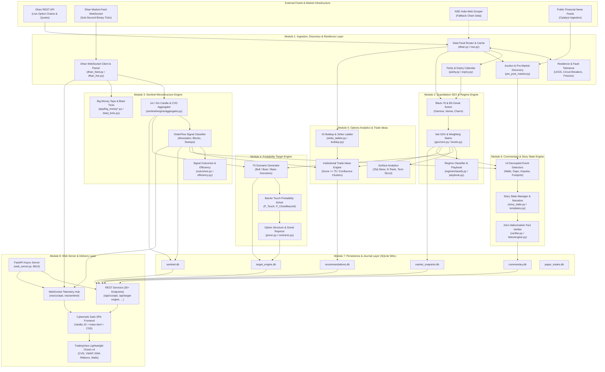
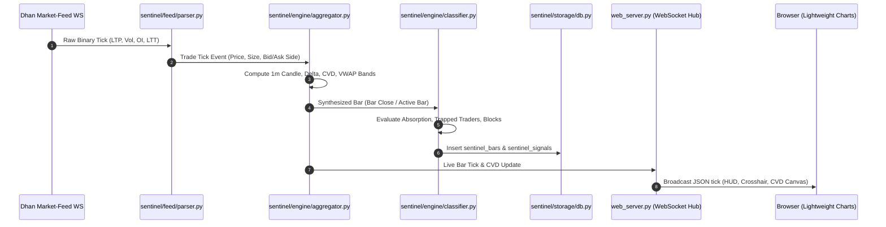
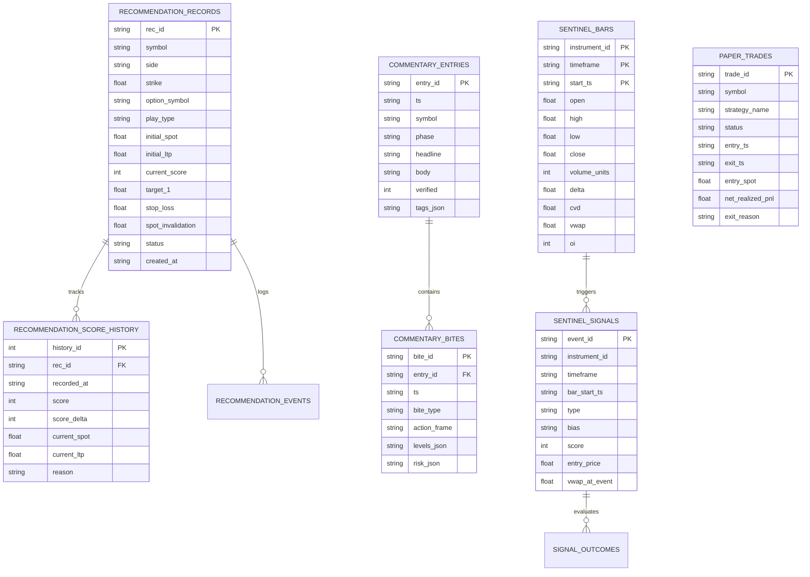
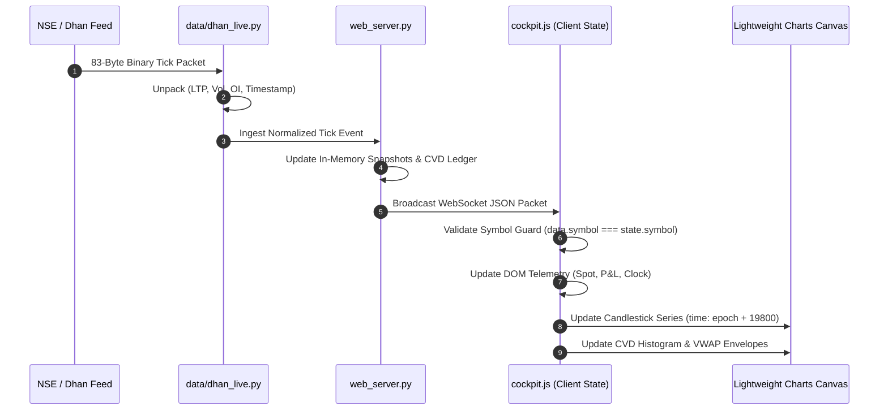
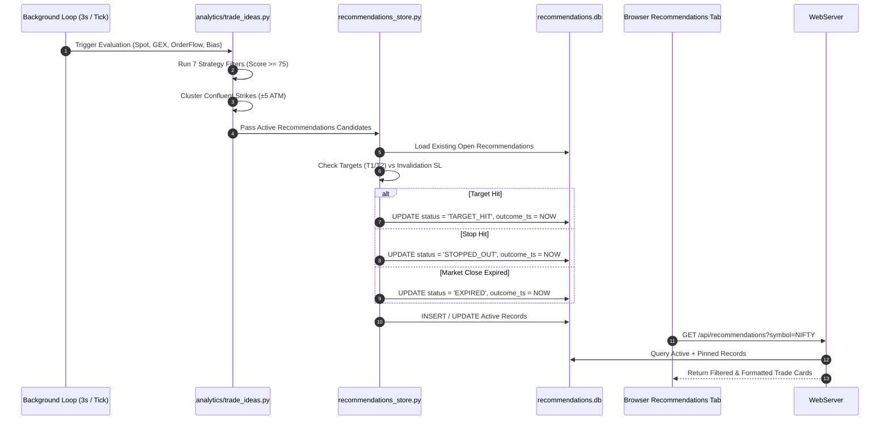

# Technical Design Document: Cubera GEX Cockpit
**System**: Cubera GEX Cockpit — Institutional Options Analytics, Microstructure & Quantitative Decision-Support Platform  
**Version**: 5.3.0  
**Target Instruments**: NIFTY 50, BANK NIFTY, SENSEX (NSE / BSE Index Derivatives)  
**Timezone Baseline**: Indian Standard Time (IST, UTC+05:30)  
**Status**: Production / Live  

---

## 1. Executive Summary & Architectural Principles

### 1.1 Purpose & Mission
The **Cubera GEX Cockpit** is an ultra-low-latency, quantitative decision-support system tailored specifically for Indian index options markets (NSE Nifty 50, Bank Nifty, and BSE Sensex). The platform synthesizes:
1. **Call−put gamma book**: Black-Scholes gamma on the live chain, scaled by open interest and the index lot. Walls are the largest call-gamma and put-gamma strikes. The flip is where those magnitudes cross. The sign is call magnitude minus put magnitude. It is not a pin.
2. **OrderFlow & Sentinel Microstructure**: Sub-second trade-by-trade tape aggregation, Cumulative Volume Delta (CVD), multi-timeframe volume profiling, iceberg absorption detection, and aggressive institutional block identification.
3. **Target Engine**: three scenarios (bull, base range, bear). Touch probability and Black-76 repricing are decision support. The base case is a range. It is not a pin.
4. **Algorithmic Recommendations Engine**: Multi-strategy opportunity generation (Gamma Squeeze, Momentum, Absorption Fade, 0DTE Theta Harvest) with confluence clustering, dynamic quality scoring ($0 \text{--} 100$), and strict risk/reward profiling.
5. **Institutional Session Commentary Engine**: Decoupled multi-detector event narration producing structured market stories and conditional suggestion bites, protected by a zero-hallucination factual verifier.

### 1.2 Non-Negotiable Core Tenets
The system is built on five foundational engineering principles:
* **Advisory & Decision-Support Only**: The platform is strictly an analytical cockpit. It executes zero automated live market orders. All trade ideas and suggestion bites are conditional setups with explicit stop-losses and invalidation criteria.
* **Strict Zero-Fabrication Contract**: This process has no `simulation_mode` flag and no synthetic bar writer. A missing quote is an empty state or the last stored snapshot. A replay or simulator, when it exists, is a separate application on its own port and does not write this process’s databases.
* **Indian Market Microstructure Realities**: The US retail-buying / dealer-short-gamma assumption is treated as an unverified landmine in Indian markets due to pervasive retail option selling. The system prioritizes sign-free indicators (CVD, OI footprints, volume buildup streaks, magnet drift) over unverified dealer-sign assumptions.
* **Rigorous IST Time Alignment**: All telemetry, timestamps, and charts enforce Indian Standard Time (`UTC+05:30`). Lightweight Charts rendering in UTC are supplied epoch timestamps adjusted by $+19,800$ seconds (+5h 30m) to display authentic trading hours (`09:15` to `15:30 IST`).
* **Graceful Multi-Session Persistence**: Database architecture utilizes SQLite in WAL (Write-Ahead Logging) mode with dedicated read/write connection separation and thread-safe locks, allowing seamless off-market analysis without polling broker APIs.

---

## 2. High-Level System Architecture

The Cubera GEX Cockpit is structured into eight decoupled, highly specialized modules communicating via in-memory event buses, SQLite WAL data layers, and an asynchronous FastAPI WebSocket/REST distribution pipeline.



---

## 3. Detailed Module Breakdown & Subsystems

### Module 1: Data Ingestion, Market Discovery & Resilience Layer (`data/`, `resilience/`)

#### 1.1 Responsibilities
* Multi-source live option chain ingestion with automatic failover (Dhan REST primary $\rightarrow$ NSE JSON scraper fallback).
* Sub-second trade tick ingestion via Dhan Market-Feed WebSocket.
* Pre-market (09:00–09:08) equilibrium price discovery and post-market closing phase detection.
* Put-Call Parity solver for synthetic forward spot $S^*$ and implied carry rate ($r - q$).
* Dynamic exchange expiry calendar resolution (Weekly Tuesday/Thursday, Monthly Last Thursday).
* Fault tolerance: Last Known Good State (LKGS) caching, circuit breaker protection, off-market API call gating.

#### 1.2 Key Components & Algorithms
* **Dhan Adapter (`data/dhan.py`, `data/dhan_feed.py`, `data/dhan_live.py`)**: Connects using Dhan Client ID and static access token. Unpacks 83-byte binary ticker packets (`FeedRequestCode 21`) containing LTP, LTT, volume, and open interest.
* **NSE Fallback Scraper (`data/nse.py`)**: Browser-header disguised scraper fetching `https://www.nseindia.com/api/option-chain-indices?symbol=NIFTY` with automatic cookie rotation.
* **Parity Engine (`data/parity.py`)**:
  Computes synthetic forward spot using the Put-Call Parity formula:
  $$S^* = K + e^{r \cdot t} (C(K) - P(K))$$
  Extracts implied interest rate $r$ and dividend yield $q$ across near-the-money strike pairs.
* **Pre/Post-Market Engine (`data/pre_post_market.py`)**:
  Monitors market session state:
  * `09:00:00 -- 09:07:30`: Pre-market order collection.
  * `09:07:30 -- 09:08:00`: Equilibrium discovery & indicative open.
  * `09:08:00 -- 09:14:59`: Buffer / auction transition.
  * `09:15:00 -- 15:30:00`: Continuous regular trading session.
  * `15:30:00 -- 15:40:00`: Post-market closing price auction.
  * `15:40:00 -- 09:00:00`: Off-market closed state.
* **Resilience Guard (`resilience/`)**:
  * `lkgs.py`: Persists and retrieves Last Known Good State to guard against mid-session network drops.
  * `circuit_breaker.py`: Trips on $N \ge 3$ consecutive adapter errors, switching from Primary to Fallback.
  * `freeze.py`: Detects frozen exchange feeds when spot and timestamps fail to update for $>45$ seconds during market hours.

---

### Module 2: Quantitative GEX & Volatility Regime Engine (`gex/`, `regime/`)

#### 2.1 Mathematical Formulation
Both legs are stored negative (`short_call_short_put`). Walls are the largest call-gamma and put-gamma magnitudes. The regime total and the flip are call magnitude minus put magnitude. POSITIVE means call-heavy. NEGATIVE means put-heavy. Who hedges is unmeasured. A second sign model is rejected.

1. **Option Greeks (Black-76 / Black-Scholes)**:
   For forward price $F$, strike $K$, annualized time-to-expiry $T$, risk-free rate $r$, and implied volatility $\sigma$:
   $$d_1 = \frac{\ln(F/K) + \frac{1}{2}\sigma^2 T}{\sigma \sqrt{T}}, \quad d_2 = d_1 - \sigma \sqrt{T}$$
   $$\Gamma = e^{-r T} \frac{n(d_1)}{F \sigma \sqrt{T}} \quad \text{where } n(x) = \frac{1}{\sqrt{2\pi}} e^{-x^2 / 2}$$
   $$\text{Vanna} = \frac{\partial \Delta}{\partial \sigma} = -e^{-r T} n(d_1) \frac{d_2}{\sigma}$$
   $$\text{Charm} = \frac{\partial \Delta}{\partial T} = e^{-r T} n(d_1) \left[ \frac{d_2}{2 T} - \frac{r}{\sigma \sqrt{T}} \right]$$

2. **Net Gamma Exposure ($GEX$)**:
   $$\text{magnitude}_K = \Gamma_K \times OI_K \times S^2 \times \text{LotSize} \times 0.01$$
   Both stored legs are negative. The book balance is call magnitude minus put magnitude.

3. **Structural Levels**:
   * **Call-gamma strike**: largest call-gamma magnitude.
   * **Put-gamma strike**: largest put-gamma magnitude.
   * **Absolute Gamma Flip ($GF$)**: The price level $S$ where total market gamma crosses zero:
     $$\text{Total GEX}(S) = 0$$
   * **Magnet**: The strike with maximum absolute total gamma exposure $\max(|\text{Net GEX}_K|)$, acting as a price attractor.
   * **Max Pain**: The strike minimizing total expiry payout for option buyers:
     $$\text{Max Pain} = \arg\min_K \sum_i \left[ \max(0, S_i - K) \cdot OI_{\text{call}, i} + \max(0, K - S_i) \cdot OI_{\text{put}, i} \right]$$

4. **Regime Classification (`regime/classify.py`)**:
   * **Call-heavy book**: call-gamma magnitude is larger than put-gamma magnitude. This is not a forecast that dealers will fade the tape.
   * **Put-heavy book**: put-gamma magnitude is larger. This is not a forecast that the move will accelerate.
   * **Near the call−put balance**: the two books are close. De-size when the aggregate book and the local side of the balance disagree.

---

### Module 3: Sentinel Microstructure & OrderFlow Engine (`sentinel/`, `app/big_money*`)

#### 3.1 Architecture & Flow
Sentinel processes tick-level trades to isolate institutional footprint, volume absorption, and orderflow imbalances.



#### 3.2 Microstructure Metrics & Algorithms
* **Delta ($\Delta$)**: Aggressive Buy Volume minus Aggressive Sell Volume within the bar:
  $$\Delta = V_{\text{ask}} - V_{\text{bid}}$$
* **Cumulative Volume Delta (CVD)**: Running intraday cumulative sum of bar deltas:
  $$\text{CVD}_t = \sum_{i=1}^t \Delta_i$$
* **Volume Weighted Average Price (VWAP)** and Standard Deviation Envelopes ($\pm 1\sigma, \pm 2\sigma$):
  $$\text{VWAP}_t = \frac{\sum P_i \cdot V_i}{\sum V_i}, \quad \sigma_t = \sqrt{\frac{\sum V_i (P_i - \text{VWAP}_t)^2}{\sum V_i}}$$
* **Iceberg Absorption**: Triggered when a bar shows extreme volume ($> 2.5\times \text{SMA}_{20}(V)$) with substantial delta ($|\Delta| > 2\sigma_\Delta$) but price progress is $< 0.35\times$ bar range, indicating passive limit order absorption.
* **Big Money Tape (`app/big_money_live.py`)**: Filters individual transactions with trade value $> \text{₹}50\text{ Lakhs}$ or contract size $> 500\text{ lots}$, tagging them with aggressive trade direction and execution latency.

---

### Module 4: Probability Target Engine (`target_engine/`)

The Target Engine converts structural levels and volatility distributions into actionable, probability-weighted multi-scenario forecasts.

```mermaid
flowchart LR
    subgraph Inputs["Input Signals"]
        Spot["Current Spot Price"]
        GEX_Walls["Call/Put Walls & Flip"]
        VWAP_Sigma["VWAP Bands (±1σ, ±2σ)"]
        RV["Realized Volatility (Garman-Klass)"]
        IV_Term["IV Smile & Term Structure"]
    end

    subgraph Scenarios["Tri-Scenario Generation"]
        Bull["Bullish Expansion<br/>Target: Call Wall / VWAP +2σ"]
        Base["Base / Mean Reversion<br/>Target: Magnet / Max Pain / VWAP"]
        Bear["Bearish Breakdown<br/>Target: Put Wall / VWAP -2σ"]
    end

    subgraph Probabilities["Barrier Probability Engine"]
        FPT["First Passage Time Solver<br/>P(Touch Target)"]
        Terminal["Terminal Density Integral<br/>P(Close Beyond)"]
    end

    subgraph Candidate_Ranking["Candidate Selection (±5 Strikes ATM)"]
        Black76["Black-76 Greek Pricer"]
        Risk_Reward["T1 / T2 / T3 & Invalidation SL"]
        POP["Probability of Profit (POP)"]
    end

    Inputs --> Scenarios
    Scenarios --> Probabilities
    Probabilities --> Candidate_Ranking
```



#### 4.1 Barrier Touch Probability Formulations
Using a geometric Brownian motion with drift $\mu = r - q$ and volatility $\sigma$:
1. **$P(\text{Touch Barrier } B \text{ within horizon } T)$**:
   For an upper target barrier $B > S_0$:
   $$P(\text{Touch } B) = \Phi\left(\frac{-\ln(B/S_0) + \tilde{\mu} T}{\sigma \sqrt{T}}\right) + \left(\frac{B}{S_0}\right)^{\frac{2\tilde{\mu}}{\sigma^2}} \Phi\left(\frac{-\ln(B/S_0) - \tilde{\mu} T}{\sigma \sqrt{T}}\right)$$
   where $\tilde{\mu} = \mu - \frac{1}{2}\sigma^2$ and $\Phi(\cdot)$ is the standard normal cumulative distribution function.
2. **$P(\text{Close Beyond } B \text{ at horizon } T)$**:
   $$P(S_T \ge B) = \Phi\left(\frac{\ln(S_0/B) + \tilde{\mu} T}{\sigma \sqrt{T}}\right)$$

#### 4.2 Candidate Option Structures Table
The engine generates a 10-strike ladder ($\pm 5$ strikes around spot) evaluating:
* **Option Symbol & Side**: CE / PE with active monthly/weekly contract symbol.
* **Model Targets**: $T_1$ (conservative $0.382$ expansion), $T_2$ (structural wall anchor), $T_3$ (extreme $1.618$ extension).
* **Invalidation Stop Loss**: Strict price anchor where underlying market structure is violated.
* **Greeks & Attribution**: Forward Delta, Gamma, Vega, and projected Theta decay over the selected target horizon ($30\text{m}$ to $375\text{m}$).

---

### Module 5: Options Analytics & Algorithmic Recommendations (`analytics/`, `structures/`)

#### 5.1 Analytics Surface Suite
* **25-Delta IV Skew (`analytics/iv_skew.py`)**:
  $$\text{Skew}_{25\Delta} = IV(25\Delta \text{ Put}) - IV(25\Delta \text{ Call})$$
  Positive skew indicates institutional put protection demand; negative skew indicates call speculative chasing.
* **Intraday OI Buildup Classifier (`analytics/buildup.py`)**:
  Classifies each strike into four quadrants:
  * **Long Buildup**: $\Delta P > 0 \land \Delta OI > 0$ (Aggressive buyers accumulation)
  * **Short Buildup**: $\Delta P < 0 \land \Delta OI > 0$ (Aggressive call/put writers accumulation)
  * **Short Covering**: $\Delta P > 0 \land \Delta OI < 0$ (Sellers closing positions, bullish push)
  * **Long Unwinding**: $\Delta P < 0 \land \Delta OI < 0$ (Buyers booking profits, bearish drift)
* **PCR Bands & Dynamic Z-Scores (`analytics/pcr_bands.py`, `analytics/zscore.py`)**:
  Calculates Put-Call Ratio based on both Total OI and Volume, tracking 30-day statistical bands to detect overbought/oversold positioning.

#### 5.2 Institutional Recommendation Engine (`analytics/trade_ideas.py`)
Evaluates 7 distinct trading strategies, applying a strict quality threshold ($\text{Score} \ge 75$):
1. **ATM Momentum Play**: High delta ($\approx 0.50$), tight bid-ask spread, aligned with CVD flow and VWAP expansion.
2. **Structure at a gamma strike**: a location plus tape absorption. The strike is not a floor or a ceiling that gets defended.
3. **Gamma Squeeze / Breakdown Lotto**: OTM convexity strike near major GEX acceleration levels when Gamma Blast score exceeds $60$.
4. **OrderFlow Iceberg Absorption Fade**: Mean-reversion play fading exhausted sweeps at VWAP $\pm 1\sigma$ envelopes.
5. **Expiry afternoon**: near-the-money gamma is high because time is short. The target is a strike on the map. It is not a pin harvest.
6. **Volatility Dispersion / Long Gamma Explosion**: Exploits compressed IV prior to impending catalyst or flip break.
7. **Zero-Cost Ratio Risk Reversal**: Synthesizes 1x2 ratio structures funding OTM convexity via ATM sales.

#### 5.3 Confluence Clustering & Lifecycle State Machine
* **Confluence Clusters**: Strikes where multiple independent strategies align are elevated with high-conviction badges.
* **Lifecycle State Machine**:
  $$\text{DRAFT} \longrightarrow \text{ACTIVE} \longrightarrow \begin{cases} \text{TARGET\_HIT} & (\text{LTP} \ge T_1 \text{ or Spot reached target}) \\ \text{STOPPED\_OUT} & (\text{LTP} \le \text{SL} \text{ or Spot crossed invalidation}) \\ \text{EXPIRED} & (\text{Session closed without resolution}) \end{cases}$$

---

### Module 6: Institutional Session Commentary & Story State Engine (`commentary/`)

#### 6.1 Multi-Detector Event Architecture
Fourteen decoupled, stateless detectors evaluate incoming market data snapshots every 30 seconds:

| Detector | Source File | Detection Criteria |
|:---|:---|:---|
| **Walls** | `detectors/walls.py` | Spot approaching within 15 pts of Call/Put Wall; wall migrations; wall breaks. |
| **Secondary Walls** | `detectors/secondary_walls.py` | Buildup shifts towards secondary backup resistance/support zones. |
| **Near the magnet** | `detectors/pinned.py` | Spot within about 10 points of the magnet or max pain while absolute concentration is high. A location, not a trap. |
| **VWAP Dynamics** | `detectors/vwap_dynamics.py` | VWAP crosses, retests, and rejections at $\pm 1\sigma / \pm 2\sigma$ envelopes. |
| **Session Structure** | `detectors/session_structure.py` | Initial Balance (IB 09:15–10:15) high/low breakouts and range extensions. |
| **Opening Gap** | `detectors/gap.py` | Overnight gap open size, gap fill probability, and auction acceptance. |
| **Impulse** | `detectors/impulse.py` | High-velocity candle bars with anomalous volume and delta expansion. |
| **Footprint** | `detectors/footprint.py` | Heavy institutional tape imbalances, trapped bids/asks at extremes. |
| **Straddle Decay** | `detectors/straddle_decay.py` | ATM straddle premium burn rates vs theoretical time-decay curve. |
| **Expiry** | `detectors/expiry.py` | Closing session. Gamma is high near the money. That is not a squeeze and not a pin. |
| **PCR Flow** | `detectors/pcr_flow.py` | Rapid intraday shifts in Put-Call Ratio ($\Delta \text{PCR} > 0.15$ in 15 mins). |
| **Sector Breadth** | `detectors/sector_breadth.py` | Cross-sector confirmation across 14 NSE sectoral indices (e.g., Bank, IT, Auto). |
| **Volatility** | `detectors/volatility.py` | Sudden spikes in India VIX or ATM implied volatility. |
| **Divergences** | `detectors/divergences.py` | Price making higher highs while CVD or GEX makes lower highs. |

#### 6.2 Zero-Hallucination Fact Verifier (`commentary/narrator/verifier.py`)
To prevent LLM hallucinations:
1. Detectors produce structured JSON payloads containing exact numeric facts (e.g., `{"spot": 22888.5, "call_wall": 23000, "gap_pts": 45.2}`).
2. The Narrator generates narrative prose describing the event.
3. The **Verifier** parses all numbers, strike levels, and percentages in the generated prose and cross-checks them against the structured JSON facts.
4. If an unverified number is detected, the LLM prose is rejected, and a deterministic template from `commentary/narrator/templates.py` is published instead.

---

### Module 7: Persistence, Journal & Data Architecture (`data/journal/`, `sentinel/storage/`)

The persistence tier consists of dedicated SQLite databases configured in **Write-Ahead Logging (WAL)** mode. Readers operate with zero locking contention against background write tasks.



---

### Module 8: Web Server & Delivery Layer (`web_server.py`, `app/static/`)

#### 8.1 Async Server Architecture
* Built on **FastAPI** and **Uvicorn**, utilizing asynchronous I/O to manage HTTP requests and WebSocket streams concurrently.
* **Database Write Watch Protection**: Configured to exclude SQLite ephemeral files (`*.db*`, `*.db-shm`, `*.db-wal`) from auto-reloading to eliminate development connection drop loops.
* **REST & WebSocket Telemetry API**: Over 35 endpoints powering the 11 tabs, delivering responses in $<5\text{ms}$ via in-memory caching.

#### 8.2 Real-Time WebSocket Telemetry Protocol
* Endpoint: `/ws/cockpit` and `/ws/sentinel`
* Tick Packet Format:
  ```json
  {
    "type": "TICK",
    "symbol": "NIFTY",
    "spot": 22888.50,
    "prev_close": 22820.10,
    "net_change": 68.40,
    "pct_change": 0.30,
    "timestamp": "14:32:05 IST",
    "call_wall": 23000.0,
    "put_wall": 22700.0,
    "gamma_flip": 22850.0,
    "regime": "POSITIVE",
    "cvd": 12450.0
  }
  ```

#### 8.3 Frontend Architecture & TradingView Integration
* **Pure Vanilla JavaScript (`cockpit.js`)**: Highly optimized, lightweight reactive state management without heavy framework overhead.
* **TradingView Lightweight Charts v4 Integration**:
  * **IST Timestamp Alignment**: Adds $+19,800$ seconds (+5h 30m) to epoch seconds, ensuring the chart's UTC time engine displays Indian market trading hours (`09:15` to `15:30 IST`).
  * **Profile Switcher**: Four distinct visual rendering profiles:
    1. `⚡ Full`: Candlesticks, CVD sub-pane, VWAP bands ($\pm 1\sigma, \pm 2\sigma$), EMA 9/21 ribbons, Call/Put GEX walls.
    2. `🎯 Pure`: Clean candlesticks, VWAP, and horizontal GEX structural walls only.
    3. `🌊 CVD`: Candlesticks with prominent Cumulative Volume Delta oscillator and zero-line delta markers.
    4. `📈 Trend`: Dual EMA ribbon regime with dynamic trend exhaustion shading.
  * **Autoscale Provider**: Overrides chart scaling to include active Call Wall and Put Wall coordinates without compressing price action.

---

## 4. End-to-End Runtime Data Flows

### 4.1 Real-Time Tick-to-Chart Sequence



### 4.2 Recommendation Generation & Lifecycle Evaluation



---

## 5. Directory & File Mapping Matrix

```
cubera-gex-cockpit/
├── analytics/                      # Deep Options & Quantitative Analytics
│   ├── bias.py                     # Macro directional bias model (-10 to +10)
│   ├── buildup.py                  # Quadrant OI buildup (Long/Short Buildup/Covering)
│   ├── directional_bias.py         # Multi-factor conviction aggregator
│   ├── iv_skew.py                  # 25-Delta IV smile & skew calculator
│   ├── max_pain.py                 # Mathematical max pain strike solver
│   ├── pcr_bands.py                # Put-Call Ratio statistical bands
│   ├── strike_ladder.py            # Strike-by-strike footprint ladder
│   └── trade_ideas.py              # Institutional Recommendations Engine (Score >= 75)
├── app/                            # Shared services and the web cockpit assets
│   ├── big_money_live.py           # Real-time institutional transaction tape
│   ├── data_access.py              # Chain load used by web_server.py
│   └── static/                     # Web frontend
│       ├── css/cockpit.css         # Cybernetic Dark Mode design system
│       ├── js/cockpit.js           # Vanilla JS reactive client engine
│       ├── index.html              # 11-Tab institutional Single Page Application
│       └── lightweight-charts.*.js # TradingView Lightweight Charts engine v4
├── commentary/                     # Real-Time Session Story & Suggestion Engine
│   ├── bites/                      # Suggestion bite generation & lifecycle gating
│   ├── detectors/                  # 14 Decoupled market condition detectors
│   ├── narrator/                   # Prose templates & zero-hallucination verifier
│   ├── story_state.py              # Narrative continuity & intraday memory manager
│   └── storage/db.py               # SQLite WAL store for commentary timeline
├── config.py                       # Master configuration, contract lot sizes & flags
├── data/                           # Data Ingestion, Broker Adapters & Schemas
│   ├── dhan.py                     # Dhan REST API client
│   ├── dhan_feed.py                # Dhan binary WebSocket protocol parser
│   ├── dhan_live.py                # Real-time WebSocket connection manager
│   ├── expiry.py                   # Dynamic NSE/BSE expiry calendar rules
│   ├── journal/                    # SQLite Multi-Store persistence layer
│   │   ├── market_snapshot.db      # Session closing levels and EOD snapshots
│   │   ├── paper_trades.db         # Simulated execution audit ledger
│   │   └── recommendations.db      # Recommendations lifecycle & score trajectories
│   ├── nse.py                      # Fallback NSE option chain scraper
│   ├── parity.py                   # Put-Call Parity synthetic forward solver
│   └── pre_post_market.py          # Auction phases & indicative open discovery
├── gex/                            # Core Quantitative Gamma Exposure Engine
│   ├── bs.py                       # Black-Scholes analytical Greeks (Gamma, Vanna, Charm)
│   ├── core.py                     # Net GEX profile & contract lot-size weighting
│   ├── flip.py                     # Absolute zero-gamma boundary solver
│   ├── levels.py                   # Call Wall, Put Wall, Magnet extraction
│   └── maxpain.py                  # Expiry payout minimization solver
├── regime/                         # Volatility Regime & Execution Playbook
│   ├── classify.py                 # Positive vs Negative Gamma regime classifier
│   └── playbook.py                 # Book-balance sentence. Not a hedge playbook.
├── resilience/                     # Fault Tolerance & Feed Health
│   ├── adaptive_poller.py          # Adaptive rate limiting and request scheduling
│   ├── circuit_breaker.py          # Automatic failover on connection failure
│   ├── freeze.py                   # Stale quote and frozen exchange feed detector
│   └── lkgs.py                     # Last Known Good State caching and recovery
├── sentinel/                       # OrderFlow Microstructure Engine
│   ├── engine/                     # Microstructure aggregation, CVD, and absorption
│   ├── feed/                       # Tick parser. Loads live bars or the last EOD snapshot.
│   └── storage/db.py               # SQLite store for sentinel bars and signal outcomes
├── target_engine/                  # Probability-Weighted Tri-Scenario Engine
│   ├── contracts.py                # Data contracts and candidate structure schemas
│   ├── levels.py                   # Barrier touch probability solvers (P_Touch, P_Close)
│   ├── pricer.py                   # Black-76 option pricing and Greek repricer
│   ├── scenarios.py                # Tri-Scenario (Bull, Bear, Base) model generator
│   └── storage.py                  # SQLite store for target forecasts and outcomes
└── web_server.py                   # FastAPI cybernetic web server (:8610)
```

---

## 6. Resilience, Security & Operational Guidelines

### 6.1 Off-Market Hours API Quota Gating
To protect broker rate limits and credentials:
* F&O quote calls follow `config.is_market_open` (09:15–15:40 IST, weekdays). Cockpit book data reads the latest stored snapshot when that is false. Recommendations stay closed. Public news RSS may still run.

### 6.2 Zero-Fabrication Enforcement
* This process does not generate a synthetic session. Tests that need a fixture call `load_dashboard(..., use_demo=True)` inside the test process. That flag is not a product mode and is not on the Streamlit or web screens.
* Price jitter timers, random noise generators, and prototype dummy rows are barred from production entry points.

### 6.3 Concurrency & Database Locking Discipline
* SQLite write operations utilize a single-writer thread lock (`_WRITE_LOCK`) per database file.
* Databases operate in `PRAGMA journal_mode=WAL` with `PRAGMA synchronous=NORMAL` and a 5,000ms busy timeout.
* Read connections open independently with `check_same_thread=False`, guaranteeing zero-latency non-blocking reads for UI threads.

---

## 7. Verification & Testing Strategy

The platform maintains a comprehensive automated testing suite encompassing **313+ unit and integration tests**:
1. **Mathematical Invariant Tests (`tests/test_gex.py`, `tests/test_parity.py`)**:
   * Validates Black-76 Greek calculations against closed-form benchmarks.
   * Asserts Put-Call Parity synthetic forward spot equality within $\pm 0.01$ points.
   * Tests zero-gamma flip convergence across edge-case volatility surfaces.
2. **Microstructure & Feed Tests (`tests/test_sentinel_*.py`)**:
   * Validates binary packet unpacking against live captured Dhan capture frames.
   * Verifies CVD integration and volume delta sign preservation.
   * Evaluates signal efficiency and forward outcome MFE/MAE calculation correctness.
3. **Target Engine & Pricing Tests (`tests/test_target_engine.py`)**:
   * Asserts barrier touch probability monotonicity: $P(\text{Touch } B) \ge P(\text{Close Beyond } B)$.
   * Validates option pricing and delta/gamma attribution under scenario shifts.
4. **API & Endpoints Integration Tests (`tests/test_web_server_endpoints.py`)**:
   * Validates HTTP response schemas across all 35+ REST routes.
   * Tests WebSocket broadcast throughput, client symbol filtering, and connection teardown.
   * Tests off-market session persistence and absence of live broker queries outside trading hours.
