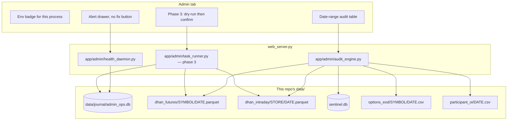

# Cubera GEX Cockpit — Admin & Data Integrity Interface
## Architecture, Design & Implementation Plan

This plan replaces the earlier one-click auto-heal design. The first deliverable is a read-only completeness audit that can be reconciled by hand against one parquet file and `data/holidays.py`. Repairs come later, for one script, behind an explicit confirm.

---

## 1. Objective

Give the operator a date-range view of whether the journals the cockpit actually reads are complete for a real trading session.

1. **Audit.** For a symbol and a date range, classify each calendar day against the NSE holiday list and the session minute grid. States are complete, partial, missing, in progress, unfillable, pending (EOD not due yet), holiday, weekend, or special session.
2. **Alerts.** A deduplicated notice when the Dhan token is near expiry or the existing spot WebSocket goes silent during a regular session. The notice links to the audit. It does not launch a script.
3. **One repair.** After the audit is trustworthy: backfill the options matrix for an explicit range, and backfill near-month futures only inside Dhan's 90-day window. Dry-run, then confirm. No other writer is exposed in the UI.

The composite "system health %" score is not part of this plan. Token life, last tick age, gap count, and WAL size stay as separate figures.

---

## 2. Out of scope

These stay out until a later plan. Shipping them inside this interface would either mis-label data or write over live state.

- **`scripts/db_cleanse_and_sync.py`.** It writes fixed book levels into `market_snapshot.db` (Nifty walls 23100/22800 and a fixed spot, with the same pattern for Bank Nifty and Sensex), deletes and remirrors sentinel bars, then runs `VACUUM`. It is not a per-day CVD rebuild. No button, alert action, or task type calls it.
- **Auto-heal** that chains futures, options, bhavcopy, and sentinel in one click.
- **Bhavcopy / participant-OI repair.** `scripts/backfill_daily.py` walks `--days` back from today (default 800). It has no start/end range. The audit checks the CSVs. A repair waits until that script grows a real range.
- **Sentinel rewrite.** The audit counts `sentinel_bars`. It does not rebuild them.
- **A sandbox data root, `data_dev/`, `data_sandbox/`, or a third port.** Journal paths are rooted at the repo (`data/dhan.py`, `app/options_eod.py`, `app/participant_oi.py`, `sentinel/storage/db.py`). Prod and dev are already two git worktrees (`cubera-gex-cockpit` on 8650, `cubera-gex-cockpit-prod` on 8640), each with its own `data/`. A third root is a separate project. See `docs/RELEASE_AND_CD_PIPELINE.md`.
- **Cross-port peer ping and an environment switcher.** A localhost link is wrong for any browser that is not on this machine. The header shows the process you are actually on.
- **Opening a second Dhan WebSocket** from the admin daemon. Feed health reads `app.ws_spot_feed.get_status()`.
- **Copying `GET /api/ops-calendar`.** That handler currently returns a fixed token life (14.5 hours) and a fixed WAL size. Admin status calls `data.dhan.token_status()` and reads real file sizes. `token_status()` never returns the token.

---

## 3. Stores the audit reads

Paths are relative to the repo root of the process being audited.

| Series | Path | Completeness check |
| :--- | :--- | :--- |
| 1-minute index futures | `data/journal/dhan_futures/<SYMBOL>/<YYYY-MM-DD>.parquet` | Unique `time_ist` (`HH:MM`) against the session grid. Columns include `open`, `high`, `low`, `close`, `volume`, `oi`. |
| 1-minute options matrix | `data/journal/dhan_intraday/<STORE>/<YYYY-MM-DD>.parquet` | Each grid minute has 21 offsets (`off` −10…+10) × 2 sides (`ce`, `pe`) = 42 distinct `(off, side)` rows. Default store key is the symbol. A non-default expiry flag lives under a suffixed key (`NIFTY_M`). |
| Sentinel 1-minute bars | `sentinel_bars` in `data/sentinel.db`, `instrument_id` `<SYMBOL>-FUT`, `timeframe` `1m` | Unique session minutes. Presence of `sentinel_daily_cvd` for that session is reported beside the bar count. It does not change the bar state. |
| EOD option chain | `data/journal/options_eod/<SYMBOL>/<YYYY-MM-DD>.csv` | File exists and parses. Written by `app/options_eod.py`. |
| Participant OI | `data/journal/participant_oi/<YYYY-MM-DD>.csv` | File exists and parses. Market-wide, one file per day, not per index (`app/participant_oi.py`). A missing file is one gap, shared across symbols. |

There is no `options_eod/<DATE>.parquet` and no `participant_oi/<DATE>.parquet`.

### Session grid

A regular session is the 375 minutes from **09:15 through 15:29 IST inclusive**. That matches `minutes_per_session = 375` already used in the target engine. The first hand-check on a known complete futures file confirms the last `time_ist` label. If that file ends at 15:30, the grid constant changes in one place and the count becomes 376. Row count alone is not completeness: 375 rows with one duplicated minute and one hole is **partial**.

Futures OHLC must also be finite, with `high` at least every other price and `low` at most every other price. A full minute set that fails this check is **partial**, reason `ohlc`.

### When 375 is the wrong expectation

| Situation | State | Repair |
| :--- | :--- | :--- |
| Today, session still open (trading day, now before 15:30 IST) | Compare only minutes up to the last closed minute. Full so far → `IN_PROGRESS`. A hole in the elapsed grid → `PARTIAL`. | Repair of today is refused while the session is open. |
| Weekend, or `data.holidays.is_trading_day` is false, and no local file | `WEEKEND` or `HOLIDAY`, with `get_holiday_name` (for example `Dussehra / Vijayadashami`). | None. |
| A file exists on a holiday or weekend (muhurat or other short session) | `SPECIAL_SESSION`. Report the observed minutes. Do not score against 375. | None, until the short-session grid is confirmed against the exchange. `2026-11-08` is listed as Diwali (Laxmi Pujan) in `NSE_HOLIDAY_NAMES`. Confirm that date before treating a file there as a gap. |
| Futures day older than today minus 89 calendar days | `UNFILLABLE`, reason `outside Dhan 90-day intraday window`. `_FUT_MAX_DAYS = 90` in `data/dhan.py`. | Button disabled. |
| Futures day inside the window, file absent | `MISSING`, note `Dhan serves only the active near-month contract`. | Phase 3 may try once. If the file is still absent afterwards, the state becomes `UNFILLABLE`, reason `not served for the active contract`. |
| Sensex futures | Audit the parquet if it is present. | `repair_available: false`. `fetch_futures_intraday` defaults to `NSE_FNO`, and `scripts/dhan_backfill_futures.py` documents Nifty and Bank Nifty. Sensex options use `BSE_FNO` and stay eligible for the options repair. |
| Bhavcopy or participant OI for session date D, before 09:15 IST on the next trading day | `PENDING`. | None. These files are published after the close, often the next morning. A 15:45 check would flag every healthy day. |
| Same files after that deadline, still absent | `MISSING`. | None in this plan. |

Sensex uses the NSE holiday list. `data/holidays.py` already records that BSE overlap is an assumption. Every Sensex audit response includes `calendar: "NSE"` and `calendar_note: "NSE holiday list applied to Sensex"`.

---

## 4. Worked calendar: 18–24 Oct 2026

The engine must reproduce this calendar from `is_trading_day` and `get_holiday_name`. Saturday 24 Oct 2026 is a weekend. Tuesday 20 Oct 2026 is Dussehra / Vijayadashami in `NSE_HOLIDAY_NAMES`. The partial row on the 21st is an illustration of shape, not a claim about the file on disk.

| Date | Weekday | Expected type |
| :--- | :--- | :--- |
| 2026-10-18 | Sunday | Weekend |
| 2026-10-19 | Monday | Trading day |
| 2026-10-20 | Tuesday | Holiday — Dussehra / Vijayadashami |
| 2026-10-21 | Wednesday | Trading day |
| 2026-10-22 | Thursday | Trading day |
| 2026-10-23 | Friday | Trading day |
| 2026-10-24 | Saturday | Weekend |

---

## 5. Architecture



The audit process only reads market files. The phase-3 runner is the only admin path that writes a journal, and only the two backfills in section 8.

---

## 6. Audit engine (`app/admin/audit_engine.py`)

Pure function over a root path, a symbol, and an inclusive date range. Tests pass a temporary root. Production passes the repo root.

For each calendar day in the range:

1. Resolve weekend, holiday name, or trading day via `data/holidays.py`.
2. If a file exists on a non-trading day, emit `SPECIAL_SESSION` and stop scoring that day.
3. Otherwise score futures, options, and sentinel against the grid in section 3.
4. Score the two CSVs as `PENDING` or present/missing using the next-trading-day 09:15 rule.
5. Set `repair_available` from the unfillable rules. Phase 1 and phase 2 leave it false even when a later phase could fill the gap.

Options status uses the same four data states as futures (`COMPLETE`, `PARTIAL`, `MISSING`, `IN_PROGRESS`), plus `UNFILLABLE` where the futures rules apply. A day file is partial when any grid minute has fewer than 42 distinct `(off, side)` pairs, or a minute is duplicated. Read only `time_ist`, `off`, and `side` (and the futures OHLC columns). A multi-month scan must not load the full options frame.

`missing_segments` lists clock ranges of absent minutes, for example `11:30-13:00`, derived from the grid rather than from a row count.

Symbol must be `NIFTY`, `BANKNIFTY`, or `SENSEX`. Anything else is a 400. `"NIFTY" in "BANKNIFTY"` must not choose a path.

---

## 7. API

Registered on the existing FastAPI app in `web_server.py`. No new authentication layer is implied by these routes. Treat them as operator actions on a process that already has unauthenticated mutating routes. The phase-3 runner stays an argv allowlist for that reason.

### `GET /api/admin/status`

Concrete readings. No percentage.

```json
{
  "environment": "dev",
  "port": 8650,
  "token_status": {
    "present": true,
    "hours_left": 13.8,
    "source": "file",
    "expired": false
  },
  "feed_status": {
    "ws_connected": true,
    "last_tick_age_s": 0.4,
    "is_live": true
  },
  "wal_sizes_mb": {
    "sentinel": 1.8,
    "market_snapshot": 0.1,
    "admin_ops": 0.2
  },
  "active_gaps_count": 1,
  "active_alerts_count": 2
}
```

`token_status` is the dict from `data.dhan.token_status()`. `feed_status` is `app.ws_spot_feed.get_status()`. WAL sizes are the byte sizes of the `-wal` files, converted to MB. `active_gaps_count` is the previous trading day's futures/options gaps once that session is closed, computed at most once per session after 15:45 IST and cached on the alert row. It is not a full-history scan on every poll.

`environment` is `COCKPIT_ENV` when set, otherwise `prod` on port 8640 and `dev` on port 8650.

### `GET /api/admin/audit`

Query: `start_date`, `end_date` (`YYYY-MM-DD`), `symbol`. Reject a range longer than 120 calendar days.

```json
{
  "symbol": "NIFTY",
  "calendar": "NSE",
  "calendar_note": null,
  "start_date": "2026-10-18",
  "end_date": "2026-10-24",
  "summary": {
    "trading_days": 4,
    "holidays": 1,
    "weekends": 2,
    "complete_days": 3,
    "gapped_days": 1,
    "missing_days": 0,
    "unfillable_days": 0,
    "participant_oi_missing_days": 0
  },
  "days": [
    {
      "date": "2026-10-24",
      "weekday": "Saturday",
      "session_kind": "WEEKEND",
      "holiday_name": null,
      "futures_status": "WEEKEND",
      "futures_bars": null,
      "options_matrix_status": "WEEKEND",
      "sentinel_status": "WEEKEND",
      "bhavcopy_status": "WEEKEND",
      "participant_status": "WEEKEND",
      "missing_segments": [],
      "repair_available": false,
      "repair_block_reason": null
    },
    {
      "date": "2026-10-21",
      "weekday": "Wednesday",
      "session_kind": "REGULAR",
      "holiday_name": null,
      "futures_status": "PARTIAL",
      "futures_bars": 120,
      "futures_expected_bars": 375,
      "options_matrix_status": "MISSING",
      "sentinel_status": "PARTIAL",
      "bhavcopy_status": "COMPLETE",
      "participant_status": "COMPLETE",
      "missing_segments": ["09:15-13:29"],
      "repair_available": false,
      "repair_block_reason": "phase 3 not enabled"
    },
    {
      "date": "2026-10-20",
      "weekday": "Tuesday",
      "session_kind": "HOLIDAY",
      "holiday_name": "Dussehra / Vijayadashami",
      "futures_status": "HOLIDAY",
      "futures_bars": null,
      "options_matrix_status": "HOLIDAY",
      "sentinel_status": "HOLIDAY",
      "bhavcopy_status": "HOLIDAY",
      "participant_status": "HOLIDAY",
      "missing_segments": [],
      "repair_available": false,
      "repair_block_reason": null
    }
  ]
}
```

`participant_oi_missing_days` counts distinct dates, not symbols.

### `GET /api/admin/alerts`

Query: `unread_only`, optional `severity`. Returns unresolved, non-dismissed rows and the badge count. Resolved rows stay in the table for the ledger and are omitted from the badge.

### `POST /api/admin/alerts/ack`

Body: `{"alert_id": "<id>", "action": "read" | "dismiss"}`. Same acknowledgement idea as `POST /api/recommendations/alerts/ack`. Dismiss hides the row. It does not stop the daemon from refreshing the same fingerprint if the condition is still true. Resolving the condition sets `resolved_at`.

### Phase 3 only

`POST /api/admin/tasks/run` with `"dry_run": true` returns the plan and does not spawn anything.

```json
{
  "task_type": "backfill_options",
  "symbol": "NIFTY",
  "start_date": "2026-10-21",
  "end_date": "2026-10-21",
  "dry_run": true
}
```

A second POST with `"confirm": true` and the same parameters starts the task. A POST without `dry_run` or `confirm` is a 400. There is no `auto_heal_range` task type.

`GET /api/admin/tasks/{task_id}` returns status, timestamps, exit code, and the last 500 lines of the log file.

`POST /api/admin/tasks/{task_id}/cancel` sends terminate to that child only, then marks the row `INTERRUPTED` if the process ends.

There is no `GET /api/admin/env/peers`.

---

## 8. Phase 3 repair contract (`app/admin/task_runner.py`)

Allowlisted argv only. The stored `argv_json` is a record of what ran. Nothing passes it through a shell.

| `task_type` | Argv | Rules |
| :--- | :--- | :--- |
| `backfill_options` | `python3 scripts/dhan_backfill.py <start> <end> <symbol>` | Dates are `YYYY-MM-DD`. Symbol is `NIFTY`, `BANKNIFTY`, or `SENSEX`. The script is resumable: a day already on disk is skipped without an API call. Dry-run reports days on disk, days to fetch, and page count. Cap the range at 31 calendar days per confirm. |
| `backfill_futures` | `python3 scripts/dhan_backfill_futures.py <symbol> <start> <end>` | Requires a small CLI addition. `backfill_futures_intraday` already accepts `start` and `end`; the script today takes an optional symbol only. Symbol is `NIFTY` or `BANKNIFTY`. Both dates must fall in `[today − 89 days, today]`. |

Futures repair **refuses** a range that includes today while the regular session is open (trading day, 09:15–15:30 IST). That backfill rewrites every day in the window. Options repair of today during that window requires a second confirm field, `"confirm_live_session": true`, because the live process is already the writer of today's files. Historical dates outside the open session need the single confirm only.

One lock per output path: `(store, symbol, date)`. Two symbols may run together. Two tasks that would write the same parquet may not. The lock is held in `admin_tasks` (`status = RUNNING` plus `params_json`), and checked before spawn.

Logs go to `logs/admin_tasks/<task_id>.log`. SQLite stores the path, the exit code, and at most 2 KB of the tail. On process startup, every `RUNNING` row becomes `INTERRUPTED`. `run_dev.sh` uses `--reload`, which will kill a child.

Cancel, the live-session refusal, and the 31-day cap are part of the task API, not follow-up work.

---

## 9. Alerts (`app/admin/health_daemon.py`)

A 60-second loop inside the web process. It upserts on `fingerprint`. It does not insert a new row each pass.

| Condition | Severity | Fingerprint | When it clears |
| :--- | :--- | :--- | :--- |
| `token_status()` missing, expired, or under 2 hours | `CRITICAL` | `TOKEN\|expiry` | Hours left ≥ 2, token present and unexpired |
| Hours left under 6 and at least 2 | `WARNING` | `TOKEN\|expiry` | Same fingerprint, severity updated in place |
| `get_status().last_tick_age_s` over 30 during a regular session (trading day, 09:15–15:30 IST) and the socket has been started | `CRITICAL` | `FEED\|silence\|<session date>` | Age ≤ 30, or the session is closed |
| Socket never started | `INFO` once | `FEED\|not-started` | `ws_connected` becomes true |
| `sentinel.db-wal` larger than 25 MB | `WARNING` | `DB\|sentinel-wal` | Size falls under 25 MB |

The daemon does not checkpoint or `VACUUM`. Silence outside 09:15–15:30 is the normal state of this feed (`is_ws_live` already documents that trade ticks stop). The previous-session gap warning is the cached audit result from section 7, not a second scanner.

Alert rows have no `suggested_fix` action id. The drawer can link to the audit tab with the symbol and session date filled in.

---

## 10. Schema: `data/journal/admin_ops.db`

WAL, `synchronous = NORMAL`, `busy_timeout = 5000`. Opened from `app/admin/db.py` with a dedicated connection. Market databases are not reused for these tables.

```sql
CREATE TABLE IF NOT EXISTS admin_alerts (
    alert_id     TEXT PRIMARY KEY,
    fingerprint  TEXT NOT NULL UNIQUE,
    severity     TEXT NOT NULL,          -- CRITICAL | WARNING | INFO
    category     TEXT NOT NULL,          -- TOKEN | FEED | GAP | DB
    title        TEXT NOT NULL,
    description  TEXT NOT NULL,
    session_date TEXT,                   -- YYYY-MM-DD when the alert is about a session
    created_at   TEXT NOT NULL,          -- ISO-8601 IST
    updated_at   TEXT NOT NULL,
    resolved_at  TEXT,
    is_read      INTEGER NOT NULL DEFAULT 0,
    is_dismissed INTEGER NOT NULL DEFAULT 0
);

CREATE TABLE IF NOT EXISTS admin_tasks (
    task_id      TEXT PRIMARY KEY,       -- task_YYYYMMDD_HHMMSS_xxxx
    task_type    TEXT NOT NULL,          -- backfill_options | backfill_futures
    argv_json    TEXT NOT NULL,          -- JSON array, the argv that was spawned
    status       TEXT NOT NULL,          -- QUEUED | RUNNING | COMPLETED | FAILED | INTERRUPTED
    params_json  TEXT NOT NULL,          -- symbol, start_date, end_date, store
    started_at   TEXT NOT NULL,
    ended_at     TEXT,
    exit_code    INTEGER,
    log_path     TEXT NOT NULL,
    tail_snippet TEXT NOT NULL DEFAULT ''
);
CREATE INDEX IF NOT EXISTS idx_tasks_status ON admin_tasks(status, started_at DESC);
```

---

## 11. UI

A tab `#tab-admin` on the existing cockpit page. The header badge is text for this process, for example `DEV :8650` or `PROD :8640`. The bell shows the unresolved count. Opening it lists severity, title, and an "Inspect" link. There is no "Run Auto-Fix".

```text
+================================================================================================+
|  CUBERA GEX COCKPIT    [ DEV :8650 ]    [ Alerts (1) ]    [ Token: 13.8h ]                    |
+================================================================================================+
|  [Cockpit] [Sentinel] [Options] [Journal] [Commentary] [Ops & Calendar] [Admin & Data]       |
+================================================================================================+
|  Token: 13.8h left, file     Feed: last tick 0.4s     WAL sentinel: 1.8 MB     Gaps: 1     |
+------------------------------------------------------------------------------------------------+
|  DATE-RANGE AUDIT                                                                              |
|  [ 2026-10-18 ] to [ 2026-10-24 ]   Index [ NIFTY ]   [ Inspect ]                             |
|                                                                                                |
|  Date         Kind        Futures          Options matrix     Sentinel      Bhavcopy   Part.  |
|  2026-10-23   Trading     375/375          42 x 375           synced        present    present|
|  2026-10-22   Trading     375/375          42 x 375           synced        present    present|
|  2026-10-21   Trading     120/375 partial  missing            partial       present    present|
|  2026-10-20   Holiday     Dussehra         --                 --            --         --     |
|  2026-10-19   Trading     375/375          42 x 375           synced        present    present|
|  2026-10-18   Weekend     Sunday           --                 --            --         --     |
|  2026-10-24   Weekend     Saturday         --                 --            --         --     |
+------------------------------------------------------------------------------------------------+
|  Phase 3, after the audit tests pass:                                                          |
|  [ Plan options backfill ]  then  [ Confirm and run ]     [ Plan futures backfill ]           |
|  Task log tails logs/admin_tasks/<task_id>.log                                                 |
+================================================================================================+
```

The 21 Oct options cell stays "missing" with the repair control disabled until phase 3. Futures older than the 90-day window show "unfillable" and no control.

---

## 12. Implementation order

### Phase 1 — read-only audit

- `app/admin/audit_engine.py` and `tests/test_admin_audit.py` against a temporary directory of parquet and CSV fixtures.
- `GET /api/admin/audit` and `GET /api/admin/status` (token, feed, WAL). Status may ship before alerts exist; `active_alerts_count` is 0 until phase 2.
- Admin tab: badge, four readings, audit table. No repair buttons.

### Phase 2 — alerts

- `app/admin/db.py`, the `admin_alerts` table, `health_daemon.py`, list and ack endpoints, bell.
- Gap alert reads the phase-1 audit for the previous trading day once after 15:45 IST.

### Phase 3 — one repair

- Optional `start`/`end` on `scripts/dhan_backfill_futures.py`, forwarded to `backfill_futures_intraday`.
- `admin_tasks`, `task_runner.py`, dry-run, confirm, cancel, startup `INTERRUPTED` sweep, path lock, log files.
- Repair controls appear on rows where `repair_available` is true.

Each phase stops and is checked before the next starts. Phase 1 is the change that affects a trading decision: a gap you can reconcile by hand.

---

## 13. Verification

Phase 1, in `tests/test_admin_audit.py`:

1. A futures parquet whose `time_ist` set is exactly 09:15–15:29 is `COMPLETE` (375).
2. The same 375 rows with one duplicated minute and one missing minute is `PARTIAL`, and `missing_segments` names the hole.
3. OHLC with `high < low` is `PARTIAL` even when the minute set is full.
4. 18–24 Oct 2026: the 18th and 24th are weekends, the 20th is holiday `Dussehra / Vijayadashami`, the 19th, 21st, 22nd, and 23rd are trading days. This fixture is the calendar in section 4, built by calling `is_trading_day`, not by hardcoding the table.
5. A file present on a holiday date is `SPECIAL_SESSION` and is not scored against 375.
6. A futures date older than 89 days is `UNFILLABLE`.
7. Today, with the clock frozen at 12:00 IST, a full grid through 11:59 is `IN_PROGRESS`.
8. Participant OI and bhavcopy on the session date, with the clock frozen at 16:00 IST the same day, are `PENDING`. They are `MISSING` only after 09:15 IST on the next trading day.
9. An options minute with 41 of 42 `(off, side)` pairs is `PARTIAL`.
10. `BANKNIFTY` does not resolve through a substring check on `NIFTY`.

Phase 2:

11. Token under 2 hours produces one critical row. Sixty more loops update that row. The badge stays 1. Clearing the condition sets `resolved_at` and the badge drops.
12. Feed silence does not alert at 20:00 IST or on 24 Oct 2026.

Phase 3:

13. Dry-run spawns no process and writes no parquet.
14. Confirm runs `scripts/dhan_backfill.py` with an argv of validated dates. A shell metacharacter in a date is a 400.
15. Futures confirm for a date 90 or more days ago is a 400.
16. Futures confirm that includes today, with the clock inside 09:15–15:30 IST on a trading day, is a 400.
17. A second task for the same symbol and date while the first is `RUNNING` is rejected.
18. Restarting the app marks a leftover `RUNNING` row `INTERRUPTED`.
19. No task type, alert, or endpoint imports `scripts/db_cleanse_and_sync.py`.

Hand check, once, on a real complete futures file: last `time_ist`, unique minute count, and the holiday name for 20 Oct 2026 from `get_holiday_name`.
