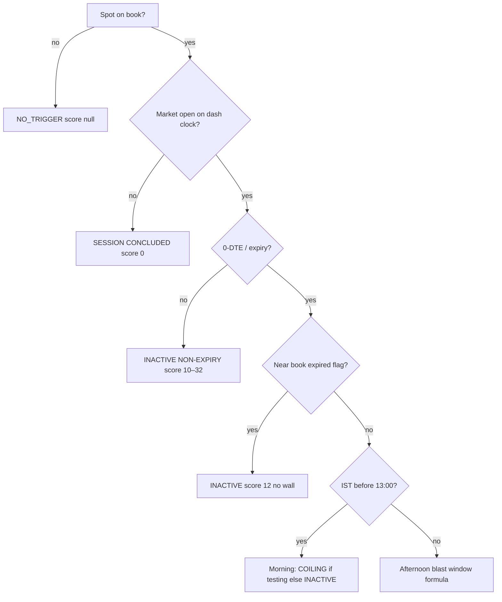

# Gamma-blast scoring — current-code guide

Source of truth: `app/gammablast.py` (helpers + both scorers), consumed by the
cockpit card (`web_server.py`), recommendation risk (`app/blast_risk.py`), and
the alert badge (`analytics/market_alert.py`). Decision-support only — **map and
risk conditioner, not a CE/PE direction model** (see `CLAUDE.md`).

There are **two related scorers**. Do not conflate them.

| Scorer | Function | What it answers | Where it shows up |
|--------|----------|-----------------|-------------------|
| **Live dashboard score** | `evaluate_dashboard_gamma_blast` | “Is expiry afternoon near / through a gamma wall, with recent covering?” | Cockpit Gamma Blast card, audio, journals, rec de-size |
| **True-vs-fake grade** | `blast_score` → `grade_blast` | “Given a completed strike *crossing*, is the break sustaining or fading?” | Crossover-watch / research (`docs/gamma-blast-score.md`, `scripts/analyze_blast.py`) |

Both are **sign-free** (raw OI + premiums / walls). Neither assumes India dealers
hedge a particular way. Neither is a forecast that price will fade or run.

---

## 1. Conceptual model

Near expiry, put–call parity at a fixed strike \(K\) collapses to:

\[
\text{call} - \text{put} \approx S - K
\]

So a premium crossover ≈ spot crossing \(K\). High gamma near that strike can
amplify a continuation — the retail “gamma blast” story. This codebase:

1. **Locates** energy (walls, magnet, concentration, anchors).
2. **Scores** nearness / breach + short-window writer covering (live card).
3. **Grades** a *past* crossing for sustain vs pin/cap (research scorer).

It does **not** say “dealers will defend this wall.” Open interest is not
buyer-versus-seller flow. Who hedges on NSE is unmeasured.

---

## 2. Live dashboard score (`evaluate_dashboard_gamma_blast`)

This is the number on the cockpit card (`score` 0–100, or `None` if no spot).

### 2.1 Return shape

```text
state            TRIGGERED | COILING | NO_TRIGGER
badge            human label (ACTIVE / COILING / INACTIVE / …)
description      plain map-language diagnostic
score            int | None
is_expiry        bool
in_blast_window  bool   # 13:00 IST ≤ t < FNO_CLOSE_MIN (15:40)
primary_strike   call or put wall chosen for the cover read | None
```

### 2.2 Hard gates (evaluated in order)



| Gate | Rule in code | Outcome |
|------|----------------|---------|
| No spot | `spot <= 0` | `NO_TRIGGER`, `score=None` |
| Session closed | `not config.is_market_open(dt_ist)` | badge `SESSION CONCLUDED`, `score=0` |
| Non-expiry | `dte_now >= 0.6` (else first listed expiry date, else `is_expiry_day`) | capped ~10–32, never ACTIVE |
| Near book dust | levels `flags` contain `"near book expired"` | `score=12`, `primary_strike=None` |
| Morning 0-DTE | expiry and `ist_min < 13:00` | testing wall → COILING @ 38; else INACTIVE @ 24 |
| Afternoon window | `13:00 ≤ ist < FNO_CLOSE_MIN` (15:40) | full ignition + proximity + regime formula |

**Clock:** `fetched_at` → IST (naive treated as UTC+5:30). Blast window is **13:00
through F&O close**, not the research afternoon cut `BLAST_AFT_CUT` (default
`13:45`) used by offline studies.

**Expiry:** `dte_now < 0.6` preferred. Fallback: first `expiries[]` date equals
IST calendar day, then `data.session_flags.is_expiry_day(symbol, date)`.

**Strike step:** Nifty `50`, Bank Nifty / Sensex `100` (proximity bands).

### 2.3 Primary strike and covering tape

Wall distances:

- `cw_dist = call_wall − spot` (if wall > 0)
- `pw_dist = spot − put_wall`

Breach / testing (Nifty step = 50 → testing band = 30 pts):

| Flag | Condition |
|------|-----------|
| `cw_breach` | `spot >= call_wall − 5` |
| `cw_testing` | `spot >= call_wall − 0.6·step` |
| `pw_breach` | `spot <= put_wall + 5` |
| `pw_testing` | `spot <= put_wall + 0.6·step` |

**Primary strike** (cover side):

1. If call testing **or** call wall is the nearer valid wall → `call_wall`, side `call`.
2. Else if put testing or put wall exists → `put_wall`, side `put`.

Each evaluate call runs `note_strike_oi(symbol, oi_strikes, dt_ist)`:

- Stores absolute `(call_oi, put_oi)` per strike.
- Replaces the last sample if within **45s** (poll storms do not fill the tape).
- Keeps **30 minutes** of history.

`window_cover_frac(symbol, strike, side, now)`:

- Needs ≥2 samples and a base at least **90 seconds** old (was 3 minutes —
  that gate left 9 Nov stuck on COILING@59).
- Prefers a sample near **now − 10 minutes**.
- Sample gap **20s** (blast lane is ~10s).
- Shared on-disk tape: `data/journal/gamma_blast_oi_tape/<SYM>.json` so web +
  timeseries + blast loop inherit covering history across processes.
- Returns `(OI_now − OI_base) / OI_base`.
  - **Negative** = covering (fuel).
  - **Positive** = OI building (defense when > +0.05).
- **Not** the day’s `call_doi` / `put_doi`. Morning build must not look like afternoon defense.

If no usable tape yet → `cover_known=False`, `cover_frac=0` for scoring, and
afternoon scores are **capped at 59** (location without ignition).

### 2.4 Afternoon point formula (0-DTE, in window)

Three additive buckets, then caps and clamp.

#### Ignition (0–40) — recent covering at primary strike

| Condition | Points |
|-----------|--------|
| `cover_frac < 0` | `min(40, (−cover_frac / 0.30) · 40)` — full at **30% OI shrink** |
| `cover_frac > 0.05` | **0** (defending) |
| else (flat / unknown tape treated as 0) | **12** baseline |

`_FULL_COVER = 0.30` is shared with the research grader.

#### Proximity & breach (0–40)

| Situation | Points |
|-----------|--------|
| Call breach | `26 + progress·14`, `progress = clip((spot − CW + 10) / (0.8·step))` |
| Put breach | `26 + progress·14`, symmetric vs put wall |
| Call testing (not breached) | `14 + (1 − cw_dist/(0.6·step))·12` |
| Put testing | same vs put |
| Neither | **6** |

So a bare breach starts ~26 and can reach 40 as spot pushes further through.

#### Regime / accelerator (0–20)

| Condition | Points |
|-----------|--------|
| `view.regime == "NEGATIVE"` | +10 |
| `flip > 0` and `spot < flip` | +10 |
| else if `total_net_gex < −1e8` | +5 |

#### Caps and clamp

```text
raw = round(ignition + proximity + regime)

if cover_known and cover_frac > 0.05:
    raw = min(raw, 34)          # defending hard-cap → stays NO_TRIGGER
elif not cover_known:
    raw = min(raw, 59)          # breach without tape → COILING max, never ACTIVE

score = clip(raw, 12, 96)
```

### 2.5 State thresholds (afternoon)

| Score | `state` | Badge (typical) |
|------:|---------|-----------------|
| ≥ 60 | `TRIGGERED` | `GAMMA BLAST: ACTIVE` |
| 35–59 | `COILING` | `GAMMA BLAST: COILING / IMMINENT` |
| < 35 | `NO_TRIGGER` | `GAMMA BLAST: INACTIVE` |

Copy is **location language** (“through the call-gamma strike… not a measured hedge”),
not “dealers defending.”

### 2.6 Non-expiry and morning scores (reference)

**Non-expiry:** base 22; +6 if testing a wall; +4 if NEGATIVE or spot &lt; flip;
clamped to **[10, 32]**. Always `NO_TRIGGER`.

**0-DTE morning (&lt; 13:00):** testing → score **38**, `COILING (PRE-BLAST)`;
else **24**, `INACTIVE (MORNING)`.

### 2.7 Worked examples (from `tests/test_gammablast.py`)

**Breach, one OI print, no 3‑min tape** → `cover_known=False` → score capped &lt; 60 →
`COILING` even with NEGATIVE regime and through the call wall.

**Same breach, OI 100k → 75k over ~10 min (−25% cover)** → ignition saturates toward
full → `TRIGGERED`, score ≥ 60. Day `call_doi` can still be largely positive; only
the short window matters.

**OI 100k → 120k (+20%) over ~10 min** → defending cap `min(raw, 34)` →
`NO_TRIGGER`, score &lt; 35.

---

## 3. True-vs-fake grade (`blast_score` / `grade_blast`)

Used when you already have a **direction** (`up` / `down`) and a time-ordered
window of OI/premium at the **crossed** strike, plus optional **ahead** strike
(same-side OI as the ITM side).

ITM side: `up → call`, `down → put`.

```text
cover_frac = (OI_end − OI_start) / OI_start     # <0 covering
prem_exp   = LTP_end / LTP_start − 1            # premium expansion
wall_ratio = OI_ahead_end / OI_crossed_end      # if ahead provided
wall_frac  = ΔOI_ahead / OI_ahead_start

ignition = clip(−cover_frac / 0.30)
thrust   = clip(prem_exp / 0.20)
path     = 1 − intact(wall)
         intact = clip(wall_ratio/3) · (1 if wall_frac > −0.15 else 0.3)

score = round(100 · (0.5·ignition + 0.2·thrust + 0.3·path))
```

| Grade | Rule |
|-------|------|
| FAKE-leaning (writers defending K) | `cover_frac > 0.05` (forced, any score) |
| TRUE-leaning | score ≥ 60 |
| WEAK / unconfirmed | 35 ≤ score &lt; 60 |
| FAKE-leaning (pin/cap) | score &lt; 35 |

Calibration anchors (tiny sample): 2026-07-02 capped up-cross vs 2026-07-03
sustaining down-cross — see `docs/gamma-blast-score.md`. Offline Spearman on
Nifty crossings is research, not a live cockpit guarantee.

**Live card does not call `blast_score`.** The afternoon card uses the point
buckets in §2.4. Shared constants: `_FULL_COVER`, `_FULL_THRUST`, and the 60 / 35
thresholds.

---

## 4. Supporting helpers (not the card score)

| Helper | Role |
|--------|------|
| `pick_anchors` / `crossover_state` / `detect_crossovers[_spot]` | Magnet + ATM premium/spot crossover watch |
| `gamma_concentration` | Top \|net_gex\| strikes within ±600 of spot |
| `next_strike` | Strike ahead in travel direction (wall-ahead input) |
| `afternoon_cut()` | Research freeze time; env `BLAST_AFT_CUT` (default `13:45`) — **not** the live 13:00 window |

---

## 5. Journaling and capture

| Path | Writer | Content |
|------|--------|---------|
| `data/journal/gamma_blast_score/<SYM>/<YYYY-MM-DD>.csv` | `journal_blast_read` / `journal_blast_from_dashboard` | One row per **IST minute** per symbol (cross-process flock): score, state, walls, cover/ignition/proximity/regime, sustain/pin fields |
| `data/journal/gamma_blast_score_minute/` | `scripts/rebuild_blast_score_minute_grid.py` | First-print collapse of a polluted day (research grid) |
| `data/journal/gamma_blast_oi_tape/` | `note_strike_oi` | Shared covering OI history across processes |
| `data/journal/blast_active_forward/` | `scripts/analyze_blast_active_forward.py` | ACTIVE episodes → spot/option forwards (research) |
| Other blast journals / ticks | timeseries / blast loops | Separate capture; **recommendations do not learn from CSV** |

`journal_blast_from_dashboard` skips non-expiry. Dedup is **on-disk** (flock +
CSV minute scan), not only in-process memory — web + timeseries + blast loop
must not leave TRIGGERED and NO_TRIGGER in the same minute.

**Live card also attaches a secondary sustain grade** (`sustain_score` /
`sustain_grade`) when cover is known; location score remains primary.

---

## 6. Downstream use of the **live** score (risk-only)

| Consumer | Behavior |
|----------|----------|
| Cockpit UI + audio | Badge/score colors; COILING → heartbeat; TRIGGERED/ACTIVE → intensity-linked engine rev |
| `analytics/market_alert.py` | Expiry + score ≥ 60 prefixes alert badge; no direction scoring |
| `app/blast_risk.py` | Expiry COILING → size × **0.75**; ACTIVE → × **0.50**; PIN/COMPRESS → × **0.40**; ACTIVE+FAKE/WEAK sustain → × **0.45**; tags / risk lines; optional short-near-magnet quality **penalty** only — **never** boosts CE/PE quality for blast |
| `analytics/trade_ideas.py` / `structures/suggest.py` | Same live eval; de-size + annotate; shorts nudged off magnet / primary strike |

Learning from score journals / promoting lottery longs from blast is **out of
scope** of current production behavior.

---

## 7. How to hand-check a live afternoon print

1. Confirm expiry (`dte_now < 0.6`) and IST in `[13:00, 15:40)`.
2. Note call/put walls and whether spot is testing or through (±5 / ±0.6·step).
3. Confirm primary strike = nearer / tested wall; side = call or put.
4. From the strike-OI tape, compute 3–10 min cover fraction (not day ΔOI).
5. Add ignition + proximity + regime; apply defending / unknown-tape caps.
6. Map score → state with 60 / 35 cutoffs.

If the card says ACTIVE with no covering tape, that is a bug relative to §2.4
(`not cover_known` ⇒ max 59).

---

## 8. Honest limits (as coded / researched)

- Live score is a **nearness + short-window covering + regime** heuristic on walls.
- True-vs-fake grader is calibrated on a **tiny** Nifty event set; Bank Nifty transfer is weak in research scripts.
- Covering needs a few minutes of absolute OI history — first prints after restart stay COILING at best.
- Score is **not** a direction call and must not be used to raise directional quality.
- Morning build in `*_doi` is intentionally ignored for defense/fuel.

---

## 🔗 Related Technical Documentation

- [🗺️ Indian GEX Playbook & Research Manual](/?view=gex_playbook)
- [📘 Master Cockpit User Guide](/?view=user_guide)
- [🎯 Options Recommendation Strategies & Alpha Playbook](/?view=options_strategies_guide)
- [📊 Quantitative Calculations & Formulas Reference](/?view=data_dictionary)

Code / research notes (repo paths, not in-app guides): `app/gammablast.py`,
`tests/test_gammablast.py`, `docs/gamma-blast-score.md`, `app/blast_risk.py`.
