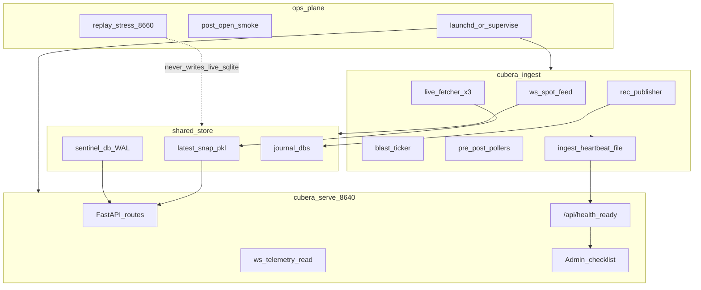

# High Reliability Plan — Cubera GEX Cockpit

Status: **plan only** (2026-11-13). Do not treat this as permission to implement
until explicitly approved.

**Scope:** make the application highly reliable *in general* — availability,
correctness under failure, operability, and recoverable data — not only the
Phase-A “don’t invent numbers / don’t look healthy when dead” pass already
shipped in [system-reliability-plan.md](system-reliability-plan.md) (v5.3.117).

**Product constraint unchanged:** decision support for Nifty / Bank Nifty /
Sensex. No auto-execution. A silent wrong number beats a loud outage for P&L
harm; both must be rare.

---

## 1. What “highly reliable” means here

For this desk app, high reliability is four simultaneous properties:

| Property | Definition of done |
|----------|-------------------|
| **Truthful** | Missing/stale/degraded data is labeled or refused. Never presented as live invent. |
| **Available** | Decision screen (HTTP + WS telemetry) stays up when ingest is sick; ingest recovers without operator heroics. |
| **Observable** | Within 60s an operator can answer: is the book live? which index? which gate refused? which process? |
| **Recoverable** | Tape, snaps, and journals survive a crash/restart; known restore path; no silent gap after restart. |

Phase A (done) mostly bought **Truthful**. This plan buys **Available +
Observable + Recoverable** without undoing Truthful.

---

## 2. Baseline (already shipped — Phase A)

Do not re-litigate; extend:

- Deep `/api/health` + `?ready=1` ([app/readiness.py](../app/readiness.py))
- Fail-loud UI banner/toasts; fabrication seeds cleared
- Hard gates registry ([app/hard_gates.py](../app/hard_gates.py))
- WAL PASSIVE checkpoint; holiday fail-loud
- Admin session-open checklist; [sli-slo.md](sli-slo.md)
- Isolation **design locked** in [process-isolation-design.md](process-isolation-design.md)

Remaining structural risks (from that design + session evals):

1. Single FastAPI process = ingest stall takes down UI
2. Dhan token/feed SPOF; NSE fallback incomplete for Sentinel OI
3. SLOs defined but not enforced (no error-budget burn path)
4. No chaos/soak against degrade paths on a separate host
5. Client is a large SPA with residual soft paths
6. Backup/restore and bar-completeness not first-class SLIs

---

## 3. Target architecture

Contracts (non-negotiable — copy from isolation design):

1. HTTP never blocks on broker I/O.
2. One writer for chain publish (ingest only).
3. No `simulation_mode` / synthetic bars in serve or ingest.
4. Lots/expiry/holiday stay single-sourced in `config` / `data/expiry`.
5. Replay/stress is a **separate process/port**; never opens live SQLite for write.

---

## 4. Reliability pillars and work packages

### Pillar A — Process isolation (availability)

**Goal:** UI survives ingest death; ingest survives UI reload.

| Step | Deliverable | Done when |
|------|-------------|-----------|
| A1 | `scripts/run_ingest.py` + `run_ingest.sh` — same lanes as today, no `:8640` bind | Ingest alone publishes snaps + Sentinel bars |
| A2 | Serve honors `COCKPIT_INGEST_EXTERNAL=1` — skip `_start_ingest_lanes` | Serve boots without Dhan threads |
| A3 | Ingest heartbeat file/row (`ingest.heartbeat` age) | Serve readiness fails if heartbeat > 90s in session |
| A4 | Dual supervise in `run_prod.sh` / launchd — restart each independently | Kill ingest → UI shows DEGRADED, not blank crash; kill serve → ingest keeps writing |
| A5 | (Later) Sentinel writer only in ingest; serve opens DB read-only | Mid-session SQLite writer stall does not freeze HTTP |

**Primary files:** [web_server.py](../web_server.py) `_start_ingest_lanes`, [app/live_fetcher.py](../app/live_fetcher.py), [app/readiness.py](../app/readiness.py), [scripts/promote.sh](../scripts/promote.sh), new `scripts/run_ingest.py`.

**Risk:** split bugs can double-write snaps. Mitigate with explicit “writer identity” log field and single-writer assert on publish.

### Pillar B — SLO enforcement (observable + actionable)

**Goal:** burn of error budget is visible and alerted, not only documented.

| Step | Deliverable | Done when |
|------|-------------|-----------|
| B1 | Minute rollup writer: ready/not-ready, chain age, feed age, CB state | **Done** — `slo.readiness.minute` |
| B2 | Health daemon CRITICAL when session readiness false > N consecutive minutes (e.g. 3) | **Done** — `SLO\|readiness-streak` |
| B3 | Tape completeness SLI: expected 1m bars vs stored (per index) after 15:45 | **Done** — checklist + `SLO\|tape-completeness` |
| B4 | Ideas VWAP blackout detector: continuous `rec.refused` Missing session VWAP after first bar | **Done** — `SLO\|vwap-blackout` |
| B5 | Post-open smoke script (09:16+): curl health/checklist/ideas; exit non-zero | **Done** — `scripts/session_open_smoke.py` + Admin |

**Primary files:** [app/admin/health_daemon.py](../app/admin/health_daemon.py), [app/session_checklist.py](../app/session_checklist.py), [docs/sli-slo.md](sli-slo.md).

**SLO targets (keep unless evidence says otherwise):**

- Readiness ≥ 99% of minutes 09:20–15:20 (exclude CB cooldown ≤ 120s)
- 0 unexplained feed silence CRITICAL
- 0 mid-session watchdog restarts on serve (ingest may still self-heal)
- 0 VWAP-blackout sessions after first 1m bar
- 0 fabricated paper tickets (400 forever)

### Pillar C — Data plane durability (recoverable)

**Goal:** crash ≠ lost session; restore is rehearsed.

| Step | Deliverable | Done when |
|------|-------------|-----------|
| C1 | Nightly backup of `sentinel.db`, `recommendations.db`, `paper_trades.db`, `admin_ops.db`, latest snaps | Timestamped copies under `data/journal/backups/` (or external disk) |
| C2 | Documented restore runbook + dry-run script (restore to *scratch* path only) | Operator can restore a prior day tape into a non-prod dir |
| C3 | WAL checkpoint policy: PASSIVE when >25MB (done); TRUNCATE once post-close if safe | Post-15:45 TRUNCATE succeeds without blocking open |
| C4 | Publish atomicity: write snap to temp then rename | No half-written pickle on crash mid-publish |
| C5 | Cold-start serve: restore LKGS from pickle before first HTTP paint | First cockpit load after restart never invents spot |

### Pillar D — Broker / feed resilience (availability under SPOF)

**Goal:** degrade loudly and usefully when Dhan is sick — not invent a second broker layer yet.

| Step | Deliverable | Done when |
|------|-------------|-----------|
| D1 | Token expiry CRITICAL already exists — add pre-open blocking checklist item if hours_left < 2 | Session checklist FAIL before 09:15 |
| D2 | Explicit degrade modes in readiness: `FEED_DOWN`, `CHAIN_DEGRADED`, `TOKEN_DEAD` | UI banner shows mode enum, not only free text |
| D3 | NSE fallback path metrics: when used, badge + obs event `nse_fallback` (counter exists — surface in checklist) | Operator sees “book from NSE scrape” |
| D4 | Spot REST fallback already backs WS — add Admin probe “WS vs REST source” | Know which path feeds the header |
| D5 | **Non-goal for now:** multi-broker. Revisit only if Dhan outages exceed error budget two sessions in a row |

### Pillar E — Decision-path correctness under load (truthful at speed)

**Goal:** hard gates stay wired; no new “refuse forever because context missing”.

| Step | Deliverable | Done when |
|------|-------------|-----------|
| E1 | Expand [app/hard_gates.py](../app/hard_gates.py) coverage: GO FIRE premium, TE ATM IV, blast equal-walls soft-flag | Static + unit tests per gate |
| E2 | Publisher/GO/TE “context required” CI test: source inspection + one integration per gate | Promote fails if wiring removed |
| E3 | Per-tab contract test: on 503/empty, UI shows banner source key (lightweight JS fixture or Playwright later) | No silent empty Sentinel/GO |
| E4 | Lot/expiry VERIFY drill: annual calendar refresh checklist in Admin Ops | Holiday year file present; lot constants match exchange notice |

### Pillar F — Client / UX reliability

**Goal:** the SPA cannot look like a calm market when the API is degraded.

| Step | Deliverable | Done when |
|------|-------------|-----------|
| F1 | Single `ReliabilityController` state machine: OK / DEGRADED / NOT_READY / OFF_SESSION | One banner source of truth (extend current `_fetchDegraded`) |
| F2 | Stale-while-revalidate rules: show last good book with `is_degraded` age; never clear to fabricated placeholders | Matches server LKGS semantics |
| F3 | WS reconnect backoff + “telemetry stale” chip tied to last tick age | Chip turns warn at 5s, critical at 30s in session |
| F4 | Reduce fire-and-forget `.catch(() => {})` on money-adjacent prefs to logged degrade | Audit pass with allowlist for audio-only |

### Pillar G — Chaos, soak, and session proof

**Goal:** prove degrade paths without touching live SQLite writers.

| Step | Deliverable | Done when |
|------|-------------|-----------|
| G1 | Stand up stress/replay host per [websocket-simulator-replay-and-stress-engine-plan.md](websocket-simulator-replay-and-stress-engine-plan.md) on port **8660** | Separate process; no write to live DBs |
| G2 | Scripted fault injection against *serve* reading fixture snaps: empty chain, CB OPEN, stale spot, missing VWAP context | Checklist turns FAIL for each injected fault |
| G3 | Pre-open soak: 30 min ingest+serve under prod supervise before first use of a release on a weekly expiry day | No watchdog restart; readiness green after 09:16 |
| G4 | Keep writing session-evaluation notes; add “reliability scorecard” section (ready minutes, restarts, refuses) | Each session eval cites SLI burn |

### Pillar H — Promote / ops reliability

**Goal:** bad builds cannot look like a successful promote.

| Step | Deliverable | Done when |
|------|-------------|-----------|
| H1 | Promote Stage 1 includes `tests/test_readiness.py`, `test_hard_gates.py`, `test_session_checklist.py`, `test_wal_checkpoint.py` | **Shipped** — mandatory file list + pytest in [scripts/promote.sh](../scripts/promote.sh) |
| H2 | Post-deploy smoke asserts `version` == new tag **and** `readiness` key present | **Shipped** — asserts `ready` / `degrade_mode` / `probes.ingest` |
| H3 | Rollback drill documented (`./scripts/rollback.sh`) once per quarter | **Shipped** — [rollback-drill.md](rollback-drill.md) + `scripts/rollback_drill.sh` |
| H4 | Dev (8650) optionally arms a softer watchdog (log-only) so stalls are visible before prod | **Shipped** — `COCKPIT_WATCHDOG=soft` / `watchdog.stall` (no execv) |

---

## 5. Phased delivery order (recommended)

Implement in this order so each phase leaves the desk safer even if the next slips:

| Phase | Pillars | Outcome | Depends on |
|-------|---------|---------|------------|
| **B — Isolate** | A1–A4 | UI ≠ ingest fate | Isolation design (done) |
| **C — Enforce** | B1–B5, H1–H2 | SLO burns alert; promote proves readiness | Phase B heartbeat helpful but B1–B2 can start in single-process |
| **D — Durable** | C1–C5 | Crash-safe snaps + backups | Independent; can parallel with B |
| **E — Client + gates** | E, F | SPA and gates cannot regress quietly | Phase A hard_gates |
| **F — Chaos** | G | Faults proven off live DBs | Replay host plan; ideally after B |
| **G — Broker degrade UX** | D | Named degrade modes | Readiness enum extension |

**Explicit deferrals**

- Kubernetes / multi-host
- Multi-broker abstraction
- Splitting per-index into three ingest processes
- In-process simulator / `simulation_mode`

---

## 6. Success criteria (declare “highly reliable”)

Call the system highly reliable only when **all** are true for two consecutive full sessions (including one expiry day):

1. Serve process mid-session restart count = 0 while ingest may restart ≤ 1 with DEGRADED UI (not invent).
2. Session readiness minute ratio ≥ 99% (09:20–15:20).
3. Admin checklist PASS by 09:20 without manual DB surgery.
4. Zero Ideas VWAP-blackout; zero fabricated execute; equal walls soft-flagged not invented.
5. Backup from prior night restores a readable Sentinel day into scratch.
6. At least one chaos drill on :8660 for empty-chain + feed-silence shows FAIL readiness without writing live DBs.
7. Promote smoke proves version + readiness schema every release.

---

## 7. Documentation / ownership map

| Doc | Role |
|-----|------|
| [system-reliability-plan.md](system-reliability-plan.md) | Phase A assessment + what shipped |
| [process-isolation-design.md](process-isolation-design.md) | Locked split contracts |
| [sli-slo.md](sli-slo.md) | SLI/SLO numbers + degrade modes (Pillar C/D) |
| [backup-restore.md](backup-restore.md) | Nightly backup + scratch restore runbook (Phase D) |
| [chaos-drill.md](chaos-drill.md) | Chaos host :8660 + soak + scorecard (Pillar G) |
| [rollback-drill.md](rollback-drill.md) | Quarterly timed rollback (Pillar H3) |
| [session-evaluation-TEMPLATE.md](session-evaluation-TEMPLATE.md) | Session notes incl. reliability scorecard |
| **This file** | Phase B+ high-reliability roadmap |
| Session eval `docs/session-evaluation-YYYY-MM-DD.md` | Empirical burn evidence |

---

## 8. First implementation slice

Smallest end-to-end cut that changes availability:

1. Ingest entrypoint + `COCKPIT_INGEST_EXTERNAL=1` on serve — **done** (`scripts/run_ingest.py`, `run_ingest.sh`)
2. Heartbeat → readiness reason `ingest_heartbeat_stale` — **done** (`app/ingest_heartbeat.py`)
3. Dual supervise in prod launchers — **done** (`run_prod.sh`; `COCKPIT_COMBINED=1` for legacy)
4. Promote gate: readiness + hard_gates tests — **done** (`scripts/promote.sh`)
5. Update [sli-slo.md](sli-slo.md) with ingest heartbeat SLI — **done**

**Ops:** default prod is dual. Emergency single-process: `COCKPIT_COMBINED=1 ./run_prod.sh`.

Stop after that slice, run one session, then continue Phase C (SLO enforcement).

---

## Disclaimer

Decision-support tooling, not financial advice. Reliability work reduces the rate
of false calm and outages; it does not make GEX predictive and does not authorize
auto-execution.
