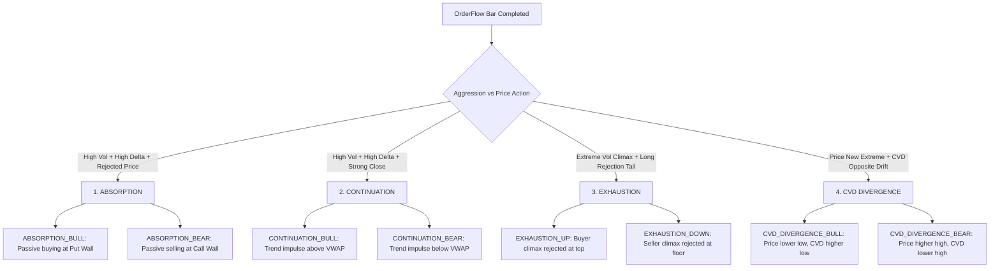

# ⚡ OrderFlow Sentinel Stream — Signals Field Guide & Reference Manual

> **Purpose:** Comprehensive trading reference for the algorithmic microstructure signals generated in the **Live OrderFlow Stream** (Sentinel Engine v2.0).  
> **Market Microstructure:** Native Indian Market Mode (`short_call_short_put` / Systematic Option Writing & Delta Hedging).  
> **Applicable Indices:** NIFTY 50, BANK NIFTY, SENSEX futures and option chains.

---

## 1. Core Order Flow Fundamentals

To interpret the Live OrderFlow Stream signals accurately, understand the four underlying microstructure mechanics:

### 1.1 Aggressive Market Orders vs. Passive Limit Orders
* **Market Orders (Aggressors):** Traders demanding immediate liquidity who cross the spread (buying at the Ask, selling at the Bid). They consume resting limit orders and push price.
* **Limit Orders (Passive Liquidity):** Market makers, institutional algorithms, and option writers placing resting bids and asks in the limit order book. They provide liquidity, absorb aggressive flow, and defend key strikes.
* Every trade has one aggressor and one passive provider. **OrderFlow analysis measures the balance between aggressive market orders and passive limit absorption.**

### 1.2 Bar Delta & Delta Ratio
* **Bar Delta ($\Delta$):**  
  $$\Delta = \text{Aggressive Buyer Volume (at Ask)} - \text{Aggressive Seller Volume (at Bid)}$$
  * Positive $\Delta$ ($+$): Net buyer aggression during the bar.
  * Negative $\Delta$ ($-$) : Net seller aggression during the bar.
* **Delta Ratio:**  
  $$\text{Delta Ratio} = \frac{\Delta}{\text{Total Bar Volume}}$$
  * Normalizes delta between $-1.00$ (100% sell aggression) and $+1.00$ (100% buy aggression).
  * Values with $|\text{Delta Ratio}| \ge 0.25$ indicate significant institutional imbalance.
  * Extreme values $|\text{Delta Ratio}| \ge 0.35$ receive confidence score bonuses.

### 1.3 Cumulative Volume Delta (CVD)
* Running sum of bar deltas from market open (09:15 IST) through the session.
* Measures whether aggregate session pressure is accumulating net buying or net selling.
* **CVD Divergence** occurs when price creates a new extreme while CVD fails to confirm it, signaling institutional exhaustion or covert absorption.

### 1.4 Time-of-Day Relative Volume ($\text{RVol}_{\text{TOD}}$)
* Compares current bar volume to the historical median volume for that exact minute of the day.
* Accounts for the typical U-shaped intraday volume curve (high volume at 09:15 open and 15:00 close; lower volume at midday).
* $\text{RVol} \ge 1.4\times$: Elevated institutional participation.
* $\text{RVol} \ge 2.0\times$: Heavy institutional surge (triggers score bonus).
* $\text{RVol} \ge 2.5\times$: Volume climax (exhaustion alert).

---

## 2. OrderFlow Signal Catalog

The Sentinel Engine identifies four primary categories of microstructure events:



---

### Signal 1: `ABSORPTION_BULL` (Institutional Floor Defense)

| Attribute | Specification |
|---|---|
| **Category / Bias** | 🟢 **BULLISH** / **LONG** |
| **Typical Confidence** | **65 – 95 / 100** (High when confirmed at Put Wall) |
| **Primary Trigger** | Heavy aggressive selling ($\Delta \text{ Ratio} < -0.20$, $\text{RVol} \ge 1.4\times$) fails to push price down (Close in upper $\ge 50\%$ of candle or lower wick $\ge 40\%$). |
| **GEX / VWAP Context** | Occurs near **Put Wall**, **VWAP $-2\sigma$**, or Day Low. |

#### Microstructure Mechanism:
Retail or algorithmic momentum sellers fire heavy market sell orders. However, institutional market makers or put option writers place huge passive limit buy orders that **absorb every single market sell order**. Despite massive negative delta, the bar refuses to close near its low and leaves a prominent buying wick.

#### Trading Playbook:
* **Entry:** Market or limit buy on the open of the next bar.
* **Stop Loss / Invalidation:** Candle closes **below** $\text{Bar Low} - 5.0\text{ pts}$.
* **Target:** VWAP / Magnet / $+1\sigma$ band (Minimum 1.5R:1).
* **Option Strategy:** Sell OTM Bull Put Spreads below Put Wall or Buy ATM Call.

---

### Signal 2: `ABSORPTION_BEAR` (Institutional Ceiling Defense)

| Attribute | Specification |
|---|---|
| **Category / Bias** | 🔴 **BEARISH** / **SHORT** |
| **Typical Confidence** | **65 – 95 / 100** (High when confirmed at Call Wall) |
| **Primary Trigger** | Heavy aggressive buying ($\Delta \text{ Ratio} > +0.20$, $\text{RVol} \ge 1.4\times$) fails to advance price (Close in lower $\le 50\%$ of candle or upper wick $\ge 40\%$). |
| **GEX / VWAP Context** | Occurs near **Call Wall**, **VWAP $+2\sigma$**, or Day High. |

#### Microstructure Mechanism:
FOMO market buyers aggressively lift the offer at resistance. Institutional participants and call option writers place large limit sell iceberg orders that **absorb the entire aggressive buying wave**. Buyers exhaust their capital, resulting in price stagnation or rejection.

#### Trading Playbook:
* **Entry:** Market or limit short on the open of the next bar.
* **Stop Loss / Invalidation:** Candle closes **above** $\text{Bar High} + 5.0\text{ pts}$.
* **Target:** VWAP / Gamma Flip / Put Wall.
* **Option Strategy:** Sell OTM Bear Call Spreads above Call Wall or Buy ATM Put.

---

### Signal 3: `CONTINUATION_BULL` (Buyer Trend Impulse)

| Attribute | Specification |
|---|---|
| **Category / Bias** | 🟢 **BULLISH** / **LONG** |
| **Typical Confidence** | **60 – 85 / 100** |
| **Primary Trigger** | Volume surge ($\text{RVol} \ge 1.5\times$) with strong positive delta ($\Delta \text{ Ratio} \ge +0.25$) and strong close near the highs ($\ge 70\%$ of bar range). |
| **GEX / VWAP Context** | Price holding **above VWAP** or breaking **Opening Range Breakout High (ORB)**. |

#### Microstructure Mechanism:
Coordinated aggressive market buying overwhelms resting limit asks. Sellers are forced to step higher, producing clean upward directional velocity without significant upper rejection wicks.

#### Trading Playbook:
* **Entry:** Immediate trend continuation entry in direction of breakout.
* **Stop Loss / Invalidation:** Candle closes **below** $\text{Bar Low} - 5.0\text{ pts}$.
* **Target:** Next GEX Wall / Upper VWAP $+2\sigma$.
* **Caveat:** If occurring directly inside the Call Wall, ensure volume is high enough for a true **Gamma Blast** (short covering) rather than late-stage exhaustion.

---

### Signal 4: `CONTINUATION_BEAR` (Seller Trend Breakdown)

| Attribute | Specification |
|---|---|
| **Category / Bias** | 🔴 **BEARISH** / **SHORT** |
| **Typical Confidence** | **60 – 85 / 100** |
| **Primary Trigger** | Volume surge ($\text{RVol} \ge 1.5\times$) with strong negative delta ($\Delta \text{ Ratio} \le -0.25$) and strong close near the lows ($\le 30\%$ of bar range). |
| **GEX / VWAP Context** | Price holding **below VWAP** or breaking **Opening Range Breakout Low (ORB)**. |

#### Microstructure Mechanism:
Aggressive institutional selling clears all bid liquidity. Passive buyers pull their bids lower, triggering stop runs and creating a downside liquidity vacuum.

#### Trading Playbook:
* **Entry:** Short entry on bar close or shallow retest of broken level.
* **Stop Loss / Invalidation:** Candle closes **above** $\text{Bar High} + 5.0\text{ pts}$.
* **Target:** Lower VWAP $-2\sigma$ / Put Wall floor.

---

### Signal 5: `EXHAUSTION_UP` (Buying Climax Rejection)

| Attribute | Specification |
|---|---|
| **Category / Bias** | 🔴 **BEARISH** / **SHORT** |
| **Typical Confidence** | **62 – 85 / 100** |
| **Primary Trigger** | Extreme volume climax ($\text{RVol} \ge 2.5\times$) closing weak (lower $\le 35\%$ of candle) with a massive upper rejection wick ($\ge 45\%$). |
| **GEX / VWAP Context** | At extended highs (above VWAP $+2\sigma$) or piercing Call Wall. |

#### Microstructure Mechanism:
A blow-off spike caused by retail stop-loss buying or late short-covering. The market runs out of aggressive buyers at higher prices, and aggressive sellers immediately push price back into the range.

#### Trading Playbook:
* **Entry:** Fade the high; enter short as price breaks back below bar open.
* **Stop Loss / Invalidation:** Candle closes **above** $\text{Bar High} + 5.0\text{ pts}$.
* **Target:** Session VWAP mean reversion.

---

### Signal 6: `EXHAUSTION_DOWN` (Selling Climax Rejection)

| Attribute | Specification |
|---|---|
| **Category / Bias** | 🟢 **BULLISH** / **LONG** |
| **Typical Confidence** | **62 – 85 / 100** |
| **Primary Trigger** | Extreme volume climax ($\text{RVol} \ge 2.5\times$) closing strong (upper $\ge 65\%$ of candle) with a massive lower rejection wick ($\ge 45\%$). |
| **GEX / VWAP Context** | At extended lows (below VWAP $-2\sigma$) or piercing Put Wall. |

#### Microstructure Mechanism:
Panic capitulation or retail stop-loss cascade. Aggressive selling exhausts itself against massive liquidity pools, triggering a fast V-reversal.

#### Trading Playbook:
* **Entry:** Enter long on the reversal confirmation.
* **Stop Loss / Invalidation:** Candle closes **below** $\text{Bar Low} - 5.0\text{ pts}$.
* **Target:** Session VWAP mean reversion.

---

### Signal 7: `CVD_DIVERGENCE_BULL` (Covert Accumulation)

| Attribute | Specification |
|---|---|
| **Category / Bias** | 🟢 **BULLISH** / **LONG** |
| **Typical Confidence** | **58 – 80 / 100** |
| **Primary Trigger** | Price prints a **lower low** while session CVD prints a **higher low** ($\text{RVol} \ge 1.2\times$). |
| **GEX / VWAP Context** | Near Put Wall, Key GEX Support, or VWAP $-1\sigma$. |

#### Microstructure Mechanism:
Price drifted slightly lower due to thin market depth, but aggressive market participants are actually buying more than selling. Institutional buyers are accumulating inventory ahead of a reversal.

#### Trading Playbook:
* **Entry:** Long entry anticipating a breakout from the descending wedge/channel.
* **Stop Loss / Invalidation:** Candle closes **below** $\text{Bar Low} - 5.0\text{ pts}$.
* **Target:** VWAP / Prior swing high.

---

### Signal 8: `CVD_DIVERGENCE_BEAR` (Covert Distribution)

| Attribute | Specification |
|---|---|
| **Category / Bias** | 🔴 **BEARISH** / **SHORT** |
| **Typical Confidence** | **58 – 80 / 100** |
| **Primary Trigger** | Price prints a **higher high** while session CVD prints a **lower high** ($\text{RVol} \ge 1.2\times$). |
| **GEX / VWAP Context** | Near Call Wall, Key GEX Resistance, or VWAP $+1\sigma$. |

#### Microstructure Mechanism:
Price edged higher on low participation, but aggressive selling volume dominated the session. Smart money is quietly dumping inventory into retail bid liquidity.

#### Trading Playbook:
* **Entry:** Short entry on failure to hold the new price high.
* **Stop Loss / Invalidation:** Candle closes **above** $\text{Bar High} + 5.0\text{ pts}$.
* **Target:** VWAP / Prior swing low.

---

## 3. Confidence Scoring Engine (0 – 100)

Every signal emitted in the stream receives an algorithmic confidence score:

| Score Range | Tier | Action Guidance |
|---|---|---|
| **75 – 100** | **HIGH** | High-probability setup with multiple confluence factors (GEX Wall + RVol + Delta). Full trading size permitted. |
| **55 – 74** | **MEDIUM** | Valid microstructure trigger. Requires confirmation with VWAP / Directional Bias before executing. |
| **< 55** | **LOW** | Exploratory or counter-trend signal. De-size or wait for follow-through. |

### Scoring Components:
* **Base Score:** $45 - 65\text{ pts}$ (based on pattern clarity).
* **RVol Multiplier:**
  * $\text{RVol} \ge 2.0\times$: $\mathbf{+15\text{ pts}}$
  * $\text{RVol} \ge 1.5\times$: $\mathbf{+8\text{ pts}}$
* **GEX Structural Alignment:**
  * Signal occurs directly at Call Wall / Put Wall (`CONFIRMED_AT_WALL`): $\mathbf{+15\text{ pts}}$
* **Delta Imbalance Severity:**
  * $|\text{Delta Ratio}| \ge 0.35$: $\mathbf{+10\text{ pts}}$
* **Anti-Spam Cooldown:** A mandatory **3-bar cooldown** prevents repeated signals of the same type during consolidations.

---

## 4. Invalidation Rules & Trade Management

Each signal card features an explicit invalidation boundary:

```
🛑 Invalidation: candle closes above 22,465.0
```

### Why "Candle Closes" vs "Wick Touch"?
1. In high-frequency Indian index futures (Nifty / Bank Nifty), institutional algorithms routinely run stop-hunts that pierce key levels by 2–5 points before snapping back.
2. An intra-bar wick touch does **not** invalidate institutional absorption or resting limit support.
3. A **candle body close** beyond the invalidation level confirms that resting liquidity has completely vanished.

> [!IMPORTANT]
> **Strict Exit Rule:** If a completed candle closes beyond the stated Invalidation Level, the microstructure thesis is dead. **Exit immediately without negotiation.** Never average into a trade whose invalidation has triggered.

### Real-Time Outcome Tracking
The stream engine tracks forward returns for all signals:
* **MFE (Maximum Favorable Excursion):** Peak profit excursion reached within 15–30 minutes.
* **MAE (Maximum Adverse Excursion):** Maximum drawdown endured during the trade.
* **Target 1R Hit:** When MFE reaches the initial risk distance ($1\times \text{Risk}$), marked with a 🎯 win badge.
* **Stopped Out:** When price breaches the invalidation level, marked with a 🛑 stop badge.

---

## 5. Integrating OrderFlow with Indian GEX Mode

In native Indian Market Mode (`short_call_short_put`), use OrderFlow signals as the **tactical trigger** and GEX Levels as the **strategic map**:

```mermaid
graph LR
    GEX[GEX Strategic Map] -->|Provides Key Levels| Level[Call Wall / Put Wall / Gamma Flip]
    OF[OrderFlow Stream] -->|Provides Real-Time Trigger| Signal[Absorption / Continuation / Climax]
    Level + Signal --> Exec[High-Confidence Trade Execution]
```

1. **At the Call Wall (e.g. 22,700 CE):**
   * If `ABSORPTION_BEAR` triggers: Call writers are actively defending their credit spreads. **Fade the rally / Sell Bear Call Spreads.**
   * If `CONTINUATION_BULL` triggers with extreme RVol ($\ge 2.0\times$): Call writers are capitulating. Expect a **Gamma Blast / Short Squeeze**. **Trade the breakout.**

2. **At the Put Wall (e.g. 22,300 PE):**
   * If `ABSORPTION_BULL` triggers: Put writers are absorbing sell flow. **Fade the drop / Sell Bull Put Spreads.**
   * If `CONTINUATION_BEAR` triggers: Put writers are pulling bids. Downside acceleration / trapdoor risk. **Exit longs immediately.**

3. **Relative to the Gamma Flip (Writer Equilibrium):**
   * **Spot > Flip:** Call writers hold higher gamma risk. Bullish continuations have smoother follow-through toward the Call Wall.
   * **Spot < Flip:** Put writers hold higher gamma risk. Downside moves have accelerated momentum.

---

## 6. Visual Playbook: Reading the Candlestick Tape & CVD Charts

The **OrderFlow Sentinel Live Tape & Microstructure Screen** integrates three coordinated subplots into a unified orderflow canvas:

```
┌──────────────────────────────────────────────────────────────┐
│  SUBPLOT 1: CANDLESTICK TAPE + GEX BOUNDARIES + VWAP         │
│  • Price Candlesticks with direct Sentinel Signal Markers    │
│  • Shaded 1σ Value Area (holds 68% of normal session volume) │
│  • Red Call Wall (Ceiling) | Green Put Wall (Floor)          │
│  • Amber Gamma Flip (Equilibrium Zero-Crossing)              │
├──────────────────────────────────────────────────────────────┤
│  SUBPLOT 2: CUMULATIVE VOLUME DELTA (CVD)                    │
│  • Dashed Zero Baseline (Above = Buyer Day | Below = Seller) │
│  • Shaded Blue CVD Line (Net session delta accumulation)     │
│  • Orange Dotted 9-EMA Line (CVD momentum trend direction)   │
├──────────────────────────────────────────────────────────────┤
│  SUBPLOT 3: BAR DELTA (Δ VOL)                                │
│  • Green Bars (Δ > 0): Aggressive Market Buys lifted Ask     │
│  • Red Bars (Δ < 0): Aggressive Market Sells dumped at Bid   │
└──────────────────────────────────────────────────────────────┘
```

### 6.1 The Four Step Orderflow Chart Inspection Sequence

Follow this simple checklist to interpret the chart in under 10 seconds:

1. **Check Price Location vs. GEX Boundaries:**
   * Is price testing the **Call Wall (🟥)**, **Put Wall (🟩)**, or **Gamma Flip (🟨)**?
   * Is price inside the **shaded 1σ Value Area** (balanced auction) or stretched beyond **$\pm 2\sigma$** (mean-reversion extreme)?

2. **Check Session CVD Baseline (The Ocean Tide):**
   * Is the blue CVD line **above the dashed zero line** (Net Institutional Buying session) or **below zero** (Net Institutional Selling session)?
   * Is CVD trending upwards above its orange 9-EMA line?

3. **Inspect Bar Delta (The Micro Battle):**
   * Are green candles supported by green delta bars (Aggressive Buyer Impulse)?
   * Or is there a **Passive Absorption Discrepancy** (e.g. green candle with red delta bar)?

4. **Look for Signal Markers (Direct Action Triggers):**
   * Green `▲` triangles below candles indicate confirmed bullish absorption or divergence.
   * Red `▼` triangles above candles indicate confirmed bearish absorption or climax exhaustion.

---

### 6.2 The Four High-Win-Rate CVD Setups

| Setup Name | Price Action | CVD Behavior | Microstructure Reality | Tactical Action |
|:---|:---|:---|:---|:---|
| **🟢 Bullish CVD Divergence** | Prints **Lower Low** | Prints **Higher Low** (or turns positive) | Aggressive sellers are dumping, but institutional passive limit buyers absorb every contract at the floor. | **BUY next bar open.** Stop: Bar low $-5\text{ pts}$. Target: VWAP or Call Wall. |
| **🔴 Bearish CVD Divergence** | Prints **Higher High** | Prints **Lower High** (or turns negative) | Aggressive retail buyers are FOMO buying, but institutional passive limit sellers absorb the move at resistance. | **SELL next bar open.** Stop: Bar high $+5\text{ pts}$. Target: VWAP or Put Wall. |
| **🚀 Bullish Impulse Trend** | Advancing upwards | Advancing upwards above orange EMA | Both aggressive market buyers and passive limit providers agree on higher value. | **RIDE Long momentum.** Trailing stop at VWAP $-1\sigma$. |
| **📉 Bearish Impulse Trend** | Descending downwards | Descending downwards below orange EMA | Both aggressive market sellers and passive liquidity pulling bids lower. | **RIDE Short momentum.** Trailing stop at VWAP $+1\sigma$. |

