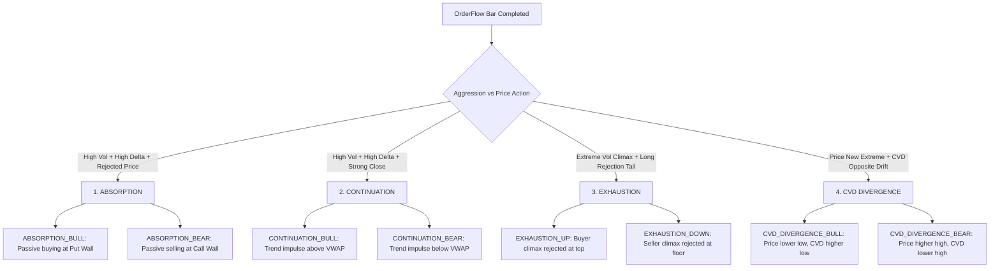

# ⚡ OrderFlow Sentinel Stream — Signals Field Guide & Reference Manual

> **Module:** Sentinel Engine v2.0 (`sentinel/` and the web cockpit)  
> **Market Microstructure:** Native Indian Market Mode (`short_call_short_put` / Systematic Option Writing & Delta Hedging)  
> **Applicable Indices:** NIFTY 50, BANK NIFTY, SENSEX futures and option chains  
> **Persistence & Storage:** SQLite WAL Mode (`data/sentinel_db.db` & `data/sentinel.db`)  

---

## 1. Core Order Flow Fundamentals

To interpret the Live OrderFlow Stream signals accurately, understand the four underlying microstructure mechanics:

### 1.1 Aggressive Market Orders vs. Passive Limit Orders
* **Market Orders (Aggressors):** Traders demanding immediate liquidity who cross the spread (buying at the Ask, selling at the Bid). They consume resting limit orders and push price.
* **Limit Orders (Passive Liquidity):** Market makers, institutional algorithms, and option writers placing resting bids and asks in the limit order book. They provide liquidity, absorb aggressive flow, and defend key strikes.
* Every trade has one aggressor and one passive provider. **OrderFlow analysis measures the balance between aggressive market orders and passive limit absorption.**

### 1.2 Bar Delta & Delta Ratio
* **Bar Delta ($\Delta$):**  
  $$\Delta = \text{Aggressive Buyer Volume (at Ask)} - \text{Aggressive Seller Volume (at Bid)}$$
  * Positive $\Delta$ ($+$): Net buyer aggression during the bar.
  * Negative $\Delta$ ($-$) : Net seller aggression during the bar.
* **Delta Ratio:**  
  $$\text{Delta Ratio} = \frac{\Delta}{\text{Total Bar Volume}}$$
  * Normalizes delta between $-1.00$ (100% sell aggression) and $+1.00$ (100% buy aggression).
  * Values with $|\text{Delta Ratio}| \ge 0.25$ indicate significant institutional imbalance.
  * Extreme values $|\text{Delta Ratio}| \ge 0.35$ receive confidence score bonuses.

### 1.3 Cumulative Volume Delta (CVD)
* Running sum of bar deltas from market open (09:15 IST) through the session:
  $$\text{CVD}_T = \sum_{t=0}^T \Delta_t$$
* **Persistent SQLite Tracking**: Stored in `sentinel_db.db`. Reloading or refreshing the cockpit **never resets CVD to zero**; the true session-wide cumulative accumulation is preserved continuously.
* Measures whether aggregate session pressure is accumulating net buying or net selling.
* **CVD Divergence** occurs when price creates a new extreme while CVD fails to confirm it, signaling institutional exhaustion or covert absorption.

### 1.4 Time-of-Day Relative Volume ($\text{RVol}_{\text{TOD}}$)
* Compares current bar volume to the historical median volume for that exact minute of the day.
* Accounts for the typical U-shaped intraday volume curve (high volume at 09:15 open and 15:00 close; lower volume at midday).
* $\text{RVol} \ge 1.4\times$: Elevated institutional participation.
* $\text{RVol} \ge 2.0\times$: Heavy institutional surge (triggers score bonus).
* $\text{RVol} \ge 2.5\times$: Volume climax (exhaustion alert).

---

## 2. OrderFlow Signal Catalog

The Sentinel Engine identifies four primary categories of microstructure events:



---

### Signal 1: `ABSORPTION_BULL` (Institutional Floor Defense)

| Attribute | Specification |
|---|---|
| **Category / Bias** | 🟢 **BULLISH** / **LONG** |
| **Typical Confidence** | **65 – 95 / 100** (High when confirmed at Put Wall) |
| **Primary Trigger** | Heavy aggressive selling ($\Delta \text{ Ratio} < -0.20$, $\text{RVol} \ge 1.4\times$) fails to push price down (Close in upper $\ge 50\%$ of candle or lower wick $\ge 40\%$). |
| **GEX / VWAP Context** | Occurs near **Put Wall**, **VWAP $-2\sigma$**, or Day Low. |

#### Microstructure Mechanism:
Retail or algorithmic momentum sellers fire heavy market sell orders. However, institutional market makers or put option writers place huge passive limit buy orders that **absorb every single market sell order**. Despite massive negative delta, the bar refuses to close near its low and leaves a prominent buying wick.

#### Trading Playbook:
* **Entry:** Market or limit buy on the open of the next bar.
* **Stop Loss / Invalidation:** Candle closes **below** $\text{Bar Low} - 5.0\text{ pts}$.
* **Target:** VWAP / Magnet / $+1\sigma$ band (Minimum 1.5R:1).
* **Option Strategy:** Sell Bull Put Spreads below Put Wall or Buy ATM Call.

---

### Signal 2: `ABSORPTION_BEAR` (Institutional Ceiling Defense)

| Attribute | Specification |
|---|---|
| **Category / Bias** | 🔴 **BEARISH** / **SHORT** |
| **Typical Confidence** | **65 – 95 / 100** (High when confirmed at Call Wall) |
| **Primary Trigger** | Heavy aggressive buying ($\Delta \text{ Ratio} > +0.20$, $\text{RVol} \ge 1.4\times$) fails to advance price (Close in lower $\le 50\%$ of candle or upper wick $\ge 40\%$). |
| **GEX / VWAP Context** | Occurs near **Call Wall**, **VWAP $+2\sigma$**, or Day High. |

#### Microstructure Mechanism:
FOMO market buyers aggressively lift the offer at resistance. Institutional participants and call option writers place large limit sell iceberg orders that **absorb the entire aggressive buying wave**. Buyers exhaust their capital, resulting in price stagnation or rejection.

#### Trading Playbook:
* **Entry:** Market or limit short on the open of the next bar.
* **Stop Loss / Invalidation:** Candle closes **above** $\text{Bar High} + 5.0\text{ pts}$.
* **Target:** VWAP / Gamma Flip / Put Wall.
* **Option Strategy:** Sell Bear Call Spreads above Call Wall or Buy ATM Put.

---

### Signal 3: `CONTINUATION_BULL` (Buyer Trend Impulse)

| Attribute | Specification |
|---|---|
| **Category / Bias** | 🟢 **BULLISH** / **LONG** |
| **Typical Confidence** | **60 – 85 / 100** |
| **Primary Trigger** | Volume surge ($\text{RVol} \ge 1.5\times$) with strong positive delta ($\Delta \text{ Ratio} \ge +0.25$) and strong close near the highs ($\ge 70\%$ of bar range). |
| **GEX / VWAP Context** | Price holding **above VWAP** or breaking **Opening Range Breakout High (ORB)**. |

#### Microstructure Mechanism:
Coordinated aggressive market buying overwhelms resting limit asks. Sellers are forced to step higher, producing clean upward directional velocity without significant upper rejection wicks.

#### Trading Playbook:
* **Entry:** Immediate trend continuation entry in direction of breakout.
* **Stop Loss / Invalidation:** Candle closes **below** $\text{Bar Low} - 5.0\text{ pts}$.
* **Target:** Next GEX Wall / Upper VWAP $+2\sigma$.

---

### Signal 4: `CONTINUATION_BEAR` (Seller Trend Breakdown)

| Attribute | Specification |
|---|---|
| **Category / Bias** | 🔴 **BEARISH** / **SHORT** |
| **Typical Confidence** | **60 – 85 / 100** |
| **Primary Trigger** | Volume surge ($\text{RVol} \ge 1.5\times$) with strong negative delta ($\Delta \text{ Ratio} \le -0.25$) and strong close near the lows ($\le 30\%$ of bar range). |
| **GEX / VWAP Context** | Price holding **below VWAP** or breaking **Opening Range Breakout Low (ORB)**. |

#### Microstructure Mechanism:
Aggressive institutional selling clears all bid liquidity. Passive buyers pull their bids lower, triggering stop runs and creating a downside liquidity vacuum.

#### Trading Playbook:
* **Entry:** Short entry on bar close or shallow retest of broken level.
* **Stop Loss / Invalidation:** Candle closes **above** $\text{Bar High} + 5.0\text{ pts}$.
* **Target:** Lower VWAP $-2\sigma$ / Put Wall floor.

---

### Signal 5: `EXHAUSTION_UP` & `EXHAUSTION_DOWN` (Climax Reversals)
* **`EXHAUSTION_UP`:** Extreme volume climax ($\text{RVol} \ge 2.5\times$) with positive delta but printing a narrow candle range and long upper wick. Indicates buyer exhaustion at resistance.
* **`EXHAUSTION_DOWN`:** Panic volume climax ($\text{RVol} \ge 2.5\times$) with negative delta printing a narrow range and long lower wick. Indicates seller capitulation at support.

---

### Signal 6: `CVD_DIVERGENCE_BULL` & `CVD_DIVERGENCE_BEAR`
* **`CVD_DIVERGENCE_BULL`:** Price prints a lower low or tests support, but CVD forms a clear higher low or trends upward. Confirms that aggressive sellers are failing to push prices down due to strong passive limit buying.
* **`CVD_DIVERGENCE_BEAR`:** Price prints a higher high, but CVD forms a lower high or drops. Confirms that aggressive buyers are losing momentum and walking into institutional sell walls.

---

## 3. Strict Invalidation Boundaries & Outcome Tracking

Each signal card features an explicit invalidation boundary:

```
🛑 Invalidation: candle closes above 22,465.0
```

### Why "Candle Closes" vs "Wick Touch"?
1. In high-frequency Indian index futures (Nifty / Bank Nifty), institutional algorithms routinely run stop-hunts that pierce key levels by 2–5 points before snapping back.
2. An intra-bar wick touch does **not** invalidate institutional absorption or resting limit support.
3. A **candle body close** beyond the invalidation level confirms that resting liquidity has completely vanished.

> [!IMPORTANT]
> **Strict Exit Rule:** If a completed candle closes beyond the stated Invalidation Level, the microstructure thesis is dead. **Exit immediately without negotiation.** Never average into a trade whose invalidation has triggered.

---

## 4. UI Ergonomics & Sub-Tabs in the Cockpit (Tab 3)

The **Sentinel Tape** interface incorporates institutional desk controls:

```
┌────────────────────────────────────────────────────────────────────────────────────────────────────────┐
│ ⚡ SENTINEL TAPE WORKSTATION                                                                            │
├────────────────────────────────────────────────────────────────────────────────────────────────────────┤
│ Controls: [Chart Height Slider: 500px - 1200px]  [⛶ Fullscreen]  [↗ Popout Window (/?view=sentinel_tape)]│
├────────────────────────────────────────────────────────────────────────────────────────────────────────┤
│ Sub-Tabs:                                                                                              │
│                                                                                                        │
│ 1. 📊 OrderFlow CVD Chart:                                                                             │
│    • Coordinated 3-pane canvas: Candlesticks + GEX Boundaries, CVD Line + 9-EMA, and Bar Delta Bars.    │
│    • Interactive TradingView / Lightweight Canvas with real-time stream updates.                      │
│                                                                                                        │
│ 2. 🌊 Volume Delta & Imbalance Profile:                                                                │
│    • Horizontal price-level volume distribution with bid/ask aggression skew.                          │
│    • Highlighting high-volume nodes (HVN), low-volume nodes (LVN), and Point of Control (POC).         │
│                                                                                                        │
│ 3. 📜 Tick Ledger & Big Money Trades:                                                                  │
│    • Streaming tick ledger showing every aggressive transaction.                                       │
│    • Automatic block-trade detection: Flags institutional orders (≥ 500 lots / 1000 lots) with         │
│      color-coded badges (🟢 Big Buy / 🔴 Big Sell) and execution time.                                │
└────────────────────────────────────────────────────────────────────────────────────────────────────────┘
```

### 4.1 Persistent SQLite Telemetry Architecture
* All tick packets and constructed bars are committed to `sentinel_db.db` via WAL journaling.
* Dual feed pipeline: Connects directly to **Dhan Live Binary Feed** (`sentinel/feed/live.py`) with automatic fallback to **Synthetic Demo Feed** (`sentinel/feed/demo.py`) during off-market hours.
* Epoch timestamps are converted to strict Indian Standard Time (IST), with automatic validation guards filtering out any future-dated tick anomalies.
