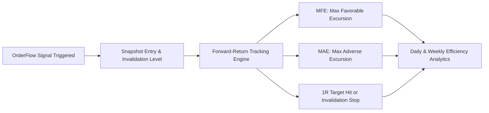

# 📈 OrderFlow Sentinel Signal Efficiency Analytics — Reference & Operational Guide

> **Module:** Sentinel Analytics v2.0  
> **Target Audience:** Quantitative traders, index derivatives discretionary traders, and systematic researchers.  
> **Applicable Indices:** NIFTY 50 (`NIFTY-FUT`), SENSEX (`SENSEX-FUT`), BANK NIFTY (`BANKNIFTY-FUT`).  
> **Underlying Storage:** SQLite WAL Mode (`data/sentinel.db`) with forward-return evaluation ledger.

---

## 1. Overview & Analytical Philosophy

The **Signal Efficiency Analytics** suite provides automated, descriptive performance measurement of all algorithmic microstructure signals emitted by the **OrderFlow Sentinel Engine**.

Rather than relying on unvalidated retrospective backtests or curve-fitted parameters, the engine applies **forward-return tracking** in real-time. Every emitted signal is locked with its exact bar timestamp, trigger price, and rule-based invalidation level, and is then tracked forward across $+1\text{m}, +3\text{m}, +5\text{m}, +15\text{m},$ and $+30\text{m}$ candles to measure price excursion.



### Core Design Principles:
1. **Strictly Descriptive:** No in-app auto-optimizer or parameter tweaking. The metrics reflect raw market reality with execution costs and slippage boundaries in mind.
2. **Excursion-Centric:** Win/loss binary outcome is insufficient for orderflow; measuring how far price ran in your favor (**MFE**) versus against you (**MAE**) uncovers the true statistical edge.
3. **GEX Wall Conditioning:** Evaluates whether signals triggered at structural Gamma Walls (`Call Wall`, `Put Wall`, `Gamma Flip`) outperform isolated orderflow signals.

---

## 2. Key Statistical Metrics Explained

### 2.1 Maximum Favorable Excursion (MFE)
* **Definition:** The highest favorable price move achieved by the contract from entry before being stopped out or closing the trade window.
* **Calculation:**
  $$\text{MFE}_{\text{Long}} = \max_{t \in [1, 30]} (\text{High}_t - \text{Entry})$$
  $$\text{MFE}_{\text{Short}} = \max_{t \in [1, 30]} (\text{Entry} - \text{Low}_t)$$
* **Interpretation:** Measures the **profit potential** of the signal. If average MFE is $+35\text{ pts}$ on Nifty, setting a take-profit target at $40\text{ pts}$ is mathematically unrealistic; targets should align within the 70th percentile of typical MFE.

### 2.2 Maximum Adverse Excursion (MAE)
* **Definition:** The deepest adverse price excursion (maximum drawdown / heat) sustained before price moves toward the target.
* **Calculation:**
  $$\text{MAE}_{\text{Long}} = \max_{t \in [1, 30]} (\text{Entry} - \text{Low}_t)$$
  $$\text{MAE}_{\text{Short}} = \max_{t \in [1, 30]} (\text{High}_t - \text{Entry})$$
* **Interpretation:** Establishes the **optimal stop-loss placement**. If 85% of winning signals never exceed $12\text{ pts}$ of MAE, setting a $25\text{ pt}$ stop is granting excessive risk to losing trades.

### 2.3 Statistical Edge Ratio
* **Definition:** The ratio of average gain excursion to average risk excursion.
  $$\text{Edge Ratio} = \frac{\text{Average MFE (pts)}}{\text{Average MAE (pts)}}$$
* **Thresholds:**
  * **$\text{Edge Ratio} \ge 1.50\times$ (Green 🟢):** Strong statistical edge. Favorable moves substantially exceed adverse heat.
  * **$1.00\times \le \text{Edge Ratio} < 1.50\times$ (Amber 🟡):** Marginal edge. Sensitive to execution friction, bid-ask spreads, and broker commission.
  * **$\text{Edge Ratio} < 1.00\times$ (Red 🔴):** Negative edge. Trades suffer more adverse drift than forward follow-through.

### 2.4 Target Hit Rate vs. Stop-Out Rate
* **Target Hit Rate ($1R$):** Percentage of signals that successfully reach a minimum $1:1$ risk-to-reward target before hitting the invalidation level.
* **Stop-Out Rate:** Percentage of signals whose low (for longs) or high (for shorts) pierced the explicit invalidation level.
* **Benchmark:** In institutional momentum trading, a **$52\% - 60\%$ hit rate** paired with an **Edge Ratio $> 1.6\times$** delivers exceptional compounding expectancy.

### 2.5 Forward Return Expectancy Curve ($+1\text{m} \to +30\text{m}$)
* Plots the average net point return across five forward time horizons: $+1\text{m}$, $+3\text{m}$, $+5\text{m}$, $+15\text{m}$, and $+30\text{m}$.
* **Immediate Impulse Pattern:** Peak return at $+3\text{m}$ to $+5\text{m}$ followed by decay indicates scalping/momentum exhaustion.
* **Trend Expansion Pattern:** Monotonically rising expectancy from $+1\text{m}$ to $+30\text{m}$ indicates genuine institutional trend continuation.

---

## 3. Dimensions of Analysis

The analytics engine dissects signal efficiency across two critical dimensions:

### 3.1 By Signal Type
* **`CONTINUATION_BULL` / `CONTINUATION_BEAR`:**
  * *Characteristics:* High delta ratio, elevated RVol, closes in upper/lower quartile, price above/below VWAP.
  * *Expected Profile:* Low MAE, rapid impulse within 3–5 bars.
* **`ABSORPTION_BEAR` / `ABSORPTION_BULL`:**
  * *Characteristics:* Heavy aggressive market orders absorbed by passive limit orders at key GEX walls. Forms upper or lower rejection wicks with delta divergence.
  * *Expected Profile:* High MFE once the trapped participants liquidate; slightly higher initial MAE during the absorption battle.
* **`EXHAUSTION_UP` / `EXHAUSTION_DOWN`:**
  * *Characteristics:* Extreme volume spike ($\text{RVol} \ge 2.5\times$) failing to make substantial progress (narrow body candle). Signals reversal or consolidation.

### 3.2 By GEX Wall Alignment
* **`CONFIRMED_AT_WALL`:**
  * Signals triggered in proximity to a **Call Wall**, **Put Wall**, or **Gamma Flip level**.
  * Historically exhibits the highest win rate and edge ratio because dealer hedging flows (positive gamma pinning or negative gamma acceleration) reinforce the orderflow thesis.
* **`NEUTRAL`:**
  * Signals occurring in open space between major strikes.
* **`COUNTER_TREND`:**
  * Signals fighting prevailing dealer delta hedging. Higher risk, requires rapid invalidation discipline.

---

## 4. Daily vs. Weekly Aggregation Modes

| Feature | Daily Mode (`YYYY-MM-DD`) | Weekly Mode (`YYYY-Www`) |
| :--- | :--- | :--- |
| **Primary Use** | Session review & intraday regime debugging | Multi-week edge consistency & strategy verification |
| **Sample Size** | 5 to 25 signals per session | 30 to 120 signals per weekly cycle |
| **Noise Filtering** | Identifies specific high-impact sessions (e.g. RBI policy days) | Smooths single-session chop to evaluate baseline rules |
| **Expiry Cycle** | Tracks 0-DTE gamma pinning dynamics | Tracks weekly expiry settlement flow (Tue for Nifty, Thu for Sensex) |

---

## 5. Target Engine Model Calibration & Options Expectancy Curve

Sub-Tab 4 (**🎯 Model Calibration & Options Expectancy**) integrates the **Target Engine Quantitative Suite** directly into the Signal Efficiency interface, bridging empirical orderflow statistics with theoretical derivative pricing models:

### 5.1 Theoretical Calibration Alpha
Rather than simply celebrating an empirical win rate, Calibration Alpha asks: **Did this signal actually outperform pure Gaussian random walk diffusion?**
- **Theoretical Touch Probability ($P_{\text{touch}}$):**
  Uses the Target Engine's reflection principle:
  $$P(\text{touch}) = 2 \cdot \left[ 1 - \Phi\left( \frac{\text{Target Distance}}{\sigma_h} \right) \right]$$
  where $\sigma_h = \text{Spot} \cdot \sigma_{\text{atm}} \cdot \sqrt{30 / (375 \times 252)}$ is the 30-minute horizon expected move.
- **Calibration Alpha Formulation:**
  $$\text{Calibration Alpha (\%)} = \text{Empirical Hit Rate (\%)} - \text{Theoretical } P(\text{touch}) (\%)$$
  - **$\text{Calibration Alpha} \ge +5.0\%$ (Green 🟢):** Strong model alpha. The orderflow trigger produces genuine directional drift well beyond random diffusion.
  - **$-5.0\% < \text{Calibration Alpha} < +5.0\%$ (Amber 🟡):** Neutral. Performance aligns closely with theoretical random walk.
  - **$\text{Calibration Alpha} \le -5.0\%$ (Red 🔴):** Model drag. Signals suffer from adverse selection or late entry execution.

### 5.2 Calibration Breakdowns
The tab breaks down Calibration Alpha across:
1. **Signal Type:** Reveals which setups (`CONTINUATION_BULL`, `ABSORPTION_BEAR`, etc.) deliver true statistical edge over diffusion.
2. **GEX Wall Alignment:** Demonstrates the substantial alpha boost achieved when orderflow signals trigger at confirmed GEX walls (`CONFIRMED_AT_WALL`) versus in open neutral space (`NEUTRAL`).

### 5.3 Black-76 Repriced ATM Option Expectancy Curve (+1m to +30m)
Underlying index forward point returns are repriced into actual ATM option contract performance:
- Evaluates entry price $V_0$ at the benchmark ATM strike.
- Reprices forward price $V_t$ at $+1\text{m}, +3\text{m}, +5\text{m}, +15\text{m},$ and $+30\text{m}$ using Black-76 forward pricing with elapsed theta time decay.
- Decomposes option PnL into:
  - **Delta PnL:** $\Delta \cdot \Delta F$ (underlying directional capture).
  - **Theta Decay Bleed:** Calendar time erosion over the holding window.

---

## 6. SQLite Data Storage & Retention Housekeeping

All bars, signals, and outcome records are stored in [`data/sentinel.db`](file:///Users/jagadish/MyProjects/Applications/cubera-gex-cockpit/data/sentinel.db).

### Retention Standards:
* **1-Minute Bars (`sentinel_bars`):** **60 calendar days**. (Sufficient for high-frequency intraday charts and multi-session tape context).
* **5-Minute Bars (`sentinel_bars`):** **180 calendar days**.
* **Signals & Outcomes (`sentinel_signals`, `signal_outcomes`):** **365 calendar days**.

### Maintenance Action:
You can execute automated retention cleanup anytime via the **`⚙️ SQLite Storage & Retention Maintenance`** expander in the tab, or programmatically via:
```python
from sentinel.storage.db import purge_old_sentinel_data
pruned_counts = purge_old_sentinel_data(bars_1m_days=60, bars_5m_days=180, signals_days=365)
print(pruned_counts)
```

---

## 7. Practical Trading Rules & Guidelines

1. **The 30-Signal Threshold:** Never alter rule sets or sizing based on fewer than 30 evaluated signals in a single category. Small samples are dominated by transient market chop.
2. **Edge Ratio Cutoff:** If a signal type drops below **$1.10\times$ Edge Ratio** over a rolling 4-week window, downgrade its category to *CAUTION* or require secondary confirmation (e.g., higher score threshold $\ge 80$).
3. **Invalidation Honesty:** If your average MAE consistently matches or exceeds the invalidation distance, entries are lagging the market. Seek earlier entry triggers or wait for pullbacks to VWAP.
4. **Calibration Discipline:** Discard or demote setups that exhibit negative Calibration Alpha, even if their nominal win rate appears acceptable.

---

## 🔗 Related Technical Documentation
- [🎯 Options Recommendation Strategies & Alpha Playbook](/?view=options_strategies_guide)
- [🎯 Target Engine — Scenario & Repricing Suite Technical Guide](/?view=target_engine_guide)
- [🔬 Options Analytics & Microstructure Intelligence Guide (IOAS v3.0)](/?view=options_analytics_guide)
- [⚡ OrderFlow Sentinel Stream Signals Field Guide](/?view=orderflow_guide)
- [🧭 Market Intelligence: Sector Breadth & News Sentiment Guide](/?view=market_intelligence_guide)
- [🎙️ Session Commentary & Suggestion Bites Guide](/?view=session_commentary_guide)
- [🌅 Pre/Post-Market Microstructure & Recommendations Lifecycle Guide](/?view=pre_post_market_guide)
- [📊 Quantitative Calculations & Formulas Reference](/?view=data_dictionary)
- [🧭 Participant Open Interest Guide](/?view=participant_guide)
- [🗺️ Indian GEX Playbook & Research Manual](/?view=gex_playbook)
- [📘 Master Cockpit User Guide](/?view=user_guide)

